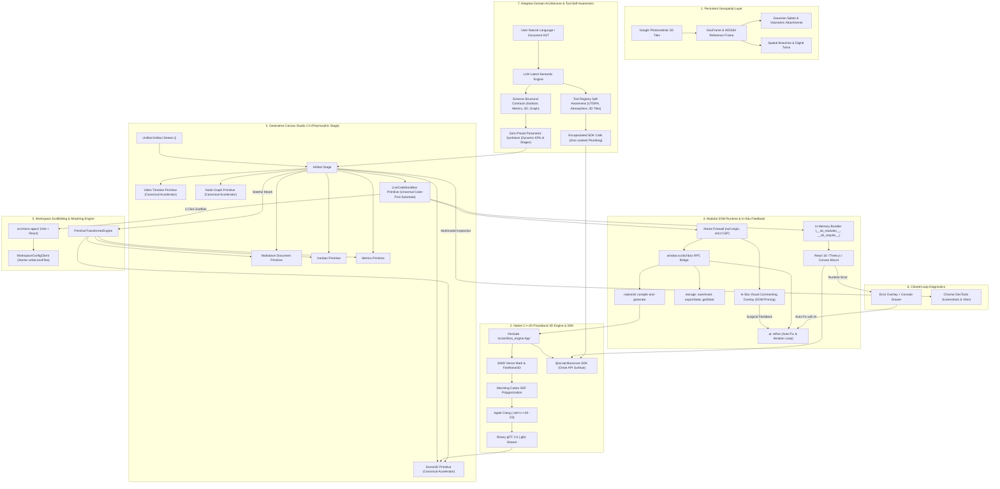

# Product Vision & Strategic Architecture

## Core Mission Statement

> "We are building a version-controlled, generative canvas for the world—unifying persistent geospatial foundations with native high-performance 3D, living code micro-apps, and autonomous agentic pair-programming. Anchored to Google’s 3D tile system and local developer workspaces, Scratchbox IDE empowers humans and AI agents to creatively branch, restyle, simulate, and compile reality."

---

## Executive Summary: The Evolution of Scratchbox IDE

Scratchbox IDE has evolved beyond a geospatial tile viewer into an **AI-native Spatial Operating System and Generative Studio**. 

Traditional software engineering tools treat spatial 3D scenes, frontend web applications, architectural documentation, and project roadmaps as disconnected silos. Scratchbox breaks down these boundaries: a single idea can be born in a conversation, materialize as a procedural C++20 3D world anchored to real-world coordinates, morph into an interactive React micro-app, scaffold into a turnkey repository package on disk, and continuously self-heal through closed-loop visual diagnostics.

---

## Strategic Pillars

### 1. Persistent Geospatial Foundation & Spatial Branching ("Git for the Physical World")
- **Immutable Global Coordinate Space**: Anchored to Google Photorealistic 3D Tiles, establishing a global, centimeter-accurate reference frame (ECEF, Local Tangent Plane, and WGS84).
- **Spatial Version Control**: Fork, branch, commit, diff, and merge 3D spatial scenes, urban interventions, and digital twins just like source code.
- **Multimodal Spatial Attachments**: Dynamically attach high-resolution 3D geometry, Gaussian splats, panoramic imagery, video feeds, and interactive micro-apps directly to real-world geographic coordinates.
- **Non-Destructive Exploration**: Explore alternate futures, zoning proposals, historical restorations, or speculative designs without mutating or corrupting the base planetary foundation.

### 2. High-Performance Procedural 3D Engine ("Lean on C/C++ First for 3D")
- **Native-First Procedural Generation**: In strict alignment with our core engineering directives, procedural geometry, terrain synthesis, and spatial physics prioritize modern C++20 (`#include "scratchbox_engine.hpp"`).
- **SIMD Math & Volumetric SDFs**: High-performance SIMD vector acceleration (`scratchbox_math.hpp`), Signed Distance Fields (SDFs), Marching Cubes polygonization, FastNoise3D (Perlin/Worley/FBM), and physically based rendering (PBR) metallic-roughness materials.
- **JIT Native Compilation & Binary Streaming**: Native C++ modules compile on-the-fly via Apple Clang (`clang++ -std=c++20 -O3`) through `NativeCppCompilerService`, streaming binary glTF 2.0 (`.glb`) chunks directly into the Three.js viewport.
- **Reproducible Generator Preservation**: The generator source code is preserved directly in `data.cppGenerator.sourceCode` (`world_generator.cpp`), guaranteeing that 3D procedural worlds remain fully editable, deterministic, and version-controlled.

### 3. The Generative Canvas & Living Multimodal Artifacts
- **Zero-Leak Primitive Protocol (`<scratchboxPrimitive>`)**: Moving beyond dead markdown text blocks and brittle regex parsers, the AI model streams directly into structured, first-class visual primitives with zero token leaks or conversational disclaimers.
- **First-Class Primitive Ecosystem**:
  - `live-code-sandbox`: Isolated, interactive React/TypeScript and Python micro-apps (simulators, synthesizers, arcade games, algorithmic visualizers).
  - `scene3d`: Real-time 3D spatial scenes, geospatial tile layers, and procedural worlds.
  - `markdown-document`: Live structured architectural specs, engineering RFCs, and API documentation.
  - `kanban`: Visual agile task boards, backlog trackers, and sprint workflows.
  - `metrics`: Dynamic telemetry dashboards, bundle analytics, and code health monitors.

### 4. Sandboxed Modular ESM Runtime & Bidirectional Host Bridge
- **In-Memory Modular ESM Bundler**: Sandboxes run a client-side transpiler and scoped module registry (`__sb_modules__`, `__sb_require__`, `__sb_normalize_path__`), enabling true multi-file ES module imports (`import { Paddle } from './components/Paddle'`) without external bundler overhead.
- **Hardened Sandbox Isolation**: The preview iframe is firewalled (`sandbox="allow-scripts allow-modals allow-forms allow-popups"`, strictly omitting `allow-same-origin` to enforce an opaque `null` origin) and governed by strict Content Security Policies (`CSP`).
- **Safe Bidirectional RPC Bridge**: Untrusted micro-apps safely communicate with the host IDE via a structured postMessage RPC protocol:
  - `window.scratchbox.storage`: Persist and hydrate runtime state across iframe hot-reloads and export assets.
  - `window.scratchbox.ai`: Dispatch contextual refinement and feature requests directly to the assistant.
  - `window.scratchbox.native3d`: Trigger native C++20 procedural compilation and glTF generation.
- **Local Dev Server & WebSocket Permissions**: Explicit CSP policies allow micro-apps to connect to local development servers (`http://localhost:*`, `ws://localhost:*`) for real-time streaming and local hardware integration.

### 5. Stateful Artifact Morphing Engine
- **Multidimensional Ideas**: Artifacts are not locked into a single static representation. A project can fluidly morph across artifact types while preserving underlying state, code generators, and telemetry:
  - **Sandbox $\rightarrow$ Scene3D**: Preserves or extracts `world_generator.cpp` targeting `scratchbox_engine.hpp` to transform a web micro-app into an immersive 3D scene.
  - **Sandbox $\rightarrow$ Document**: Synthesizes architectural documentation, file trees, dependency manifests, and operational instructions.
  - **Sandbox $\rightarrow$ Kanban**: Derives actionable roadmaps, test plans, and implementation backlogs from source code.
  - **Sandbox $\rightarrow$ Metrics**: Extracts code volume, module counts, bundle health, and runtime diagnostics into interactive telemetry charts.

### 6. 1-Click Turnkey Scaffolding & Continuous Disk Synchronization
- **Closing the Prototype-to-Production Chasm**: What starts as an in-canvas idea shouldn't get trapped in a sandbox. With a single click of the `>_ Scaffold` button, micro-apps are ejected into production-ready workspace projects:
  - Auto-generated `package.json` with React, Vite, Tailwind, and Lucide dependencies.
  - Turnkey `vite.config.ts`, `index.html`, and `tsconfig.json`.
  - Fully scaffolded source directory (`src/micro-apps/<slug>/`) ready for `npm run dev` or immediate git commit.
- **Continuous Bi-directional Filesystem Sync**: Backed by `WorkspaceConfigClient`, `writeLensFiles`, and Codebase Lens, files written to disk or modified in the editor synchronize atomically with watcher loopback suppression.

### 7. Closed-Loop Self-Healing & Visual Verification
- **Autonomous Error Trapping & Auto-Diagnostics**: Runtime errors (`window.onerror`, `window.onunhandledrejection`) are captured in real-time within the sandbox harness and mirrored to the host IDE.
- **Interactive Self-Healing**: 
  - In-canvas **Error Overlay** with stack traces and a 1-click `⚡ Auto-Fix with AI` trigger.
  - Embedded **Runtime Console Drawer** with log level filtering (`ALL`, `LOG`, `ERROR`) and line-level AI auto-repair triggers.
- **Multimodal Visual Verification Loop**: In accordance with our agent directives, agents continuously inspect their work via automated Chrome DevTools screenshots, validating geometry, material realism, UI layout, and responsive alignment before declaring completion.
- **Zero-Tolerance Quality Gates**: 100% clean TypeScript compilation (`tsc --noEmit`), strict architectural boundaries, and automated vitest regression suites across all monorepo packages.

### 8. Adaptive Domain Architecture ("Zero-Preset, Schema-Guided Intelligence")
- **The Modern AI Way (The LLM is the Domain Engine)**: Decisively eliminates rigid domain taxonomies, closed category enums (`DomainCategory = 'astrophysics' | 'biology' | ...`), and hardcoded mock profiles. The model's latent semantic space inferentially spans the infinite breadth of human disciplines without artificial keyword classifiers or static presets.
- **Rigorous Schema Contracts over Canned Mock Data**: Visual and interactive canvas primitives (`kanban`, `metrics`, `node-graph`, `scene3d`, `video-timeline`, `live-code-sandbox`) enforce strict structural contracts and TypeScript interfaces, not pre-baked content. Prompts guide structural integrity, industry-standard units, and meaningful telemetry directly tailored to the user's specific context.
- **AST-Grounded Document Projection (Zero Fake Injections)**: When morphing architectural documents into actionable task boards or telemetry dashboards, the system derives columns from document headings, cards strictly from user checklist bullets/tasks, and KPIs from in-text metrics. No canned or foreign domain profiles (e.g., Keplerian formulas or CRISPR cards) are ever hallucinated or injected.
- **Dynamic Parametric Synthesis**: All procedural assets (3D spatial models, interactive micro-apps, data pipelines) synthesize dynamically based on semantic attributes, geometric parameters, and seed variance—guaranteeing that no two creations are identical, predetermined, or hardcoded.

### 9. Coding-First to Create Anything & Live-Preview Heavy (The Universal Sandbox)
- **Code as the Infinite Substrate**: Code has unbounded expressivity (Turing-complete). No static GUI or rigid preset taxonomy can match code for building bespoke applications, historical data trackers, molecular simulators, audio synthesizers, or financial dashboards.
- **Live-Preview Heavy**: Moving far beyond text-only diffs or static markdown artifacts (Antigravity), Scratchbox immediately mounts generated code into a living, sub-second hot-reloading iframe sandbox (`live-code-sandbox`). The user experiences their creation immediately.
- **Full Code & File Transparency**: The user can inspect the multi-file project tree (`App.tsx`, components, styles, data), view syntax-highlighted Monaco editors, review diff hunks, and edit lines manually at any time.
- **In-Situ Interactive Commenting**: The user can interact with the running output and drop visual annotation pins directly onto live DOM elements (capturing DOM selectors, source-map file locations, visual crops, and feedback notes). The Gemini Agent ingests these spatial annotations to perform surgical HMR updates, closing the human-in-the-loop pairing cycle.
- **Primitives as Canonical Accelerators**: Hardcoded canvas primitives (`3d-scene`, `video-timeline`, `node-graph`, `kanban-board`, `metric-dashboard`) are **not** rigid boundaries. They are **Pre-Compiled Canonical Accelerators** designed to save developers and agents from reinventing complex wheels (e.g., C++20 Marching Cubes SDF polygonization, multi-track NLE scrubbers, SVG bezier wiring engines). When a task requires bespoke logic, the universal engine is the **Live Code Sandbox**.

### 10. Tool Self-Awareness & The Encapsulation Boundary
- **Antigravity-Style Tool Self-Awareness**: The agent maintains deep, proactive awareness of the platform's unique specialized tools (`google_3d_tiles_*`, `atmosphere_*`, `utdra_*`, `geobox_*`, `webxr_*`, `mesh_reshape_*`, `comfyui_*`) and automatically exploits them to solve complex problems.
- **Zero Leaked Plumbing (Encapsulation Boundary)**: The agent must **never** dump low-level internal engine code (e.g., 400 lines of NOAA solar ephemeris trigonometry, Sutherland-Hodgman triangle clippers, Brown-Conrady camera distortion matrices, or raw Cesium octree walkers) into the user's files or chat.
- **First-Party SDK / API Ingestion (`@scratchbox/core`)**: User-facing code in sandboxes imports cleanly from the `@scratchbox/core` SDK (e.g. `import { Google3DViewport, useAtmosphere } from '@scratchbox/core'`). The user inspects clean, concise, 20-line idiomatic application code that pulls from the platform API, while the heavy C++ engine, SIMD math, and GPU pipelines remain safely encapsulated in the core kernel.
- **Transparent Observability**: The user sees *that* the tool was used via clean telemetry badges and execution cards in chat (`☀️ Atmosphere: Calculated solar vector for Rome at 17:00`), without their code being polluted by *how* the tool was implemented.

---

## Architectural Topology

---

## The Vision in Action: Workflows of the Future

### 1. Planetary Urban Architecture & Living Digital Twins
An architect or municipal team opens a photorealistic 3D tile of Midtown Manhattan or San Francisco. They branch the tile—creating a lightweight spatial branch. Within the branch, they use the native C++20 engine to procedurally generate a bioclimatic high-rise with solar-responsive facade panels. The building is not a static mesh: attached to its lobby coordinate is a `live-code-sandbox` micro-app simulating real-time transit and energy telemetry. The team merges the branch to the master spatial layer with a single commit.

### 2. Autonomous Ideation to Production Micro-Apps
A developer prompts the AI for an audio visualizer or orbital physics simulation. The AI streams a `<scratchboxPrimitive type="live-code-sandbox">` directly into the canvas. Within milliseconds, the multi-file ESM bundle compiles in-memory and executes inside an isolated firewall. The developer interacts with the simulation, tests edge cases, and clicks `>_ Scaffold`. Immediately, turnkey Vite, TypeScript, and React configurations are generated on disk in `src/micro-apps/`, ready for continuous integration and team deployment.

### 3. Infinite Morphing & Conceptual Fluidity
A technical lead builds a complex algorithmic sorting visualizer in the code sandbox. To prepare for an executive review, they click **Morph to Document**: the system analyzes the AST and runtime telemetry to generate an architectural specification with complexity proofs. They click **Morph to Kanban**: the engine extracts missing unit tests and optimization tasks into an agile project board. They click **Morph to 3D Scene**: the algorithm is transformed into a procedural 3D data sculpture generated via C++20 and Marching Cubes.

### 4. Zero-Preset Adaptive Synthesis Across Novel Disciplines
A research team asks Scratchbox to synthesize an operational delivery pipeline for an unconstrained discipline—such as sourdough wild yeast culturing, deep-sea hydrothermal vent geochemistry, or agricultural drone pollination. Rather than matching against rigid domain keywords or falling back to canned mock templates, the **Adaptive Domain Architecture** inferentially extracts entities and project milestones directly from the prompt. It synthesizes a live interactive Kanban board with domain-authentic stages, tailored metric cards with realistic physical units, and parametric 3D models with unique seed variance—bridging the infinite breadth of human inquiry without predefined silos.

### 5. Omnipresent Code-to-Preview Loop with In-Situ Visual Annotations
A creator asks Scratchbox to "build an interactive web app that tracks the historical events of 1776." Rather than confining them to rigid static widgets or dumping raw terminal diffs, Scratchbox immediately materializes a `live-code-sandbox` containing modular React components and historical event JSON. The app runs live in the preview iframe within milliseconds. The creator clicks on an event card, drops an in-situ visual comment pin saying "Add casualty statistics and make battle dates crimson," and the Gemini Agent receives the exact DOM selector and visual crop. The Agent performs an atomic Hot Module Replacement update, turning the pin green—all while consuming clean `@scratchbox/core` APIs without exposing or reinventing low-level platform plumbing.

---

## Slogan & Tagline Concepts

### 1. Hero / Category-Defining Taglines
- **"Git for the physical world."**
- **"Persistent spatial foundations. Living code primitives. Infinite creative branches."**
- **"The version-controlled generative studio for the world."**
- **"Where geospatial reality meets autonomous generative code."**
- **"Branch reality. Compile the future."**

### 2. Action & Creative Framing
- **"Branch. Simulate. Scaffold. Compile."**
- **"Earth is the canvas. Code is the medium."**
- **"From prompt to procedural reality in one canvas."**
- **"Attach your imagination to any coordinate on Earth."**
- **"Turnkey micro-apps on top of real-world foundations."**

### 3. Engineering & Platform Framing
- **"The spatial operating system powered by C++20 and generative AI."**
- **"Zero-leak primitives. Isolated micro-apps. Native 3D performance."**
- **"From canvas prototype to production repository in one click."**
- **"Self-healing micro-apps anchored to Google 3D Tiles."**
