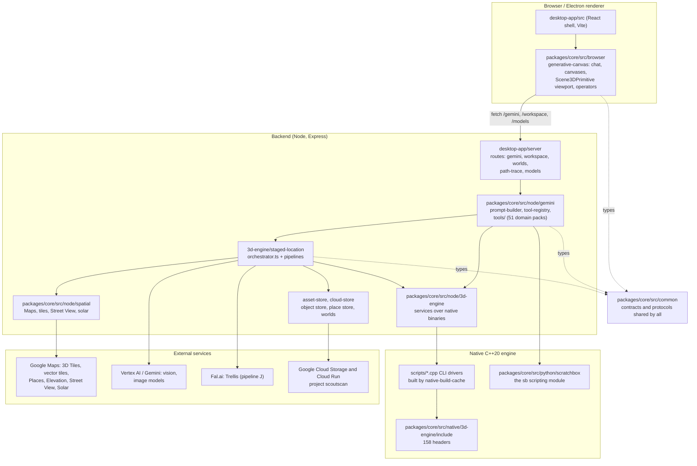
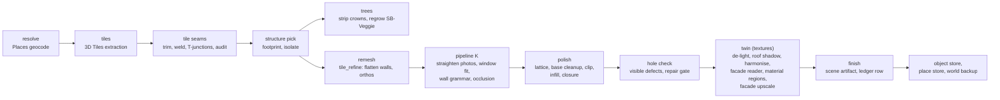
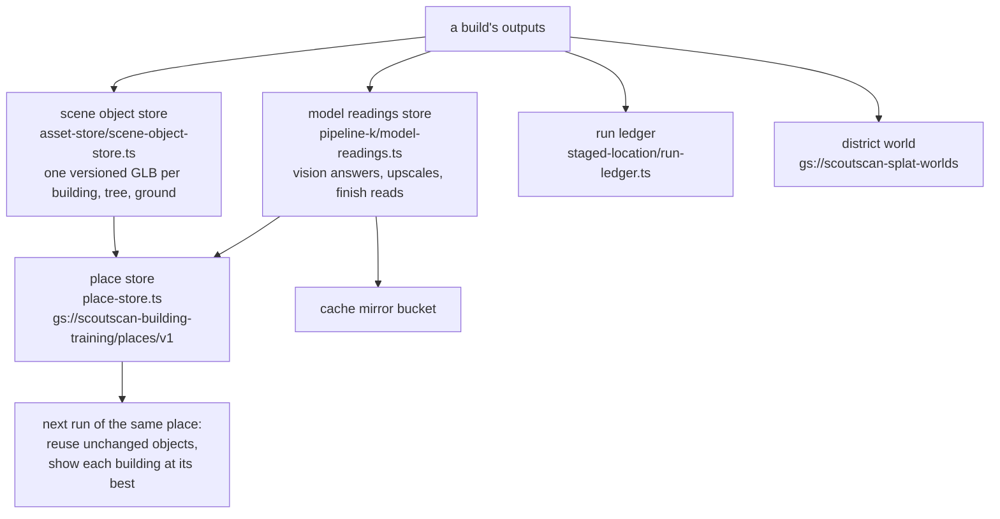

# Scratchbox IDE: development handover, 2026-11-05

Written by the coordinating Claude session ("MAIN") for the agent taking over development (Antigravity). It describes
the code on `main` at `80f8098f` (train 16), what is in flight, and how work has been run. Where something is not
verified, it says so.

**Read first, in this order:** `AGENTS.md` (the binding rules; long, and the source of truth for behaviour), this file,
then `docs/processes/README.md` (a dated index of every live test and finding).

## 1. The product in one paragraph

Scratchbox IDE is a desktop app (a React renderer over an Express backend, optionally in Electron) in which a chat
agent (Gemini models) builds and edits 3D scenes and video timelines. The current goal, in the user's words: **"create
stunning 3D environments from Google Maps data"**. A real place is staged from Google Photorealistic 3D Tiles; a single
building is cleaned and rebuilt by **pipeline K**; a whole district by **K-D** (pipeline K over chunks). Geometry is
made by a native C++20 engine and shown in Three.js. The user judges results by eye from labelled before/after sheets.

## 2. Codebase diagram

### Directory map

| Path | Tracked files | What it holds |
|---|---|---|
| `packages/core/src/node` | 676 | Backend logic: the agent, tools, 3D services, spatial services, stores |
| `packages/core/src/node/3d-engine` | about 92 entries | One service per native tool (tile refine, vegetation, seams, SB-Archi, path tracer) |
| `packages/core/src/node/3d-engine/staged-location` | about 165 entries | Real-place builds: `orchestrator.ts` and the pipelines (`pipeline-k/`, `pipeline-i/` is J, `pipeline-e/`, frozen `pipeline-g/`, `pipeline-h/`) |
| `packages/core/src/node/gemini` | | System prompt (`prompt-builder.ts`), `tool-registry.ts`, `tools/` (51 packs) |
| `packages/core/src/node/spatial` | | Google Maps, 3D Tiles, Street View, Solar, coordinate frames |
| `packages/core/src/browser` | 364 | The studio UI, canvases, the 3D viewport (`generative-canvas/primitives/Scene3DPrimitive.tsx`, `primitives/scene3d/`), viewport operators |
| `packages/core/src/common` | 98 | Contracts shared by browser and node (`spatial/staged-location-contracts.ts`, protocols) |
| `packages/core/src/native/3d-engine/include` | 158 headers | The C++20 engine (`scratchbox_engine.hpp`, `scratchbox_tile_vegetation.hpp`, `scratchbox_sb_veggie.hpp`, `scratchbox_sb_archi.hpp`, ...) |
| `packages/core/src/python/scratchbox` | 44 | The `sb` Python module the in-app model scripts scenes with |
| `packages/core/test` | about 980 files | vitest suites |
| `desktop-app` | | `server/` (Express), `src/` (renderer entry), `electron/`, `scripts/dev.js` (launcher) |
| `scripts` | 380 | Native CLI drivers (`*.cpp`), benchmarks, dev harnesses (`scripts/dev/staged-replay.ts`) |
| `assets` | | Texture library index and stats, species library (`assets/vegetation/species/index.json`) |
| `.agents/skills` | 41 | Skills the in-app model loads |
| `.claude/skills` | 18 | Skills for coding agents (`operate-scratchbox`, `screenshot-review`, `watch-staged-build`, `docs-drift-sweep`, ...) |
| `docs/processes` | | Dated records of live tests; `README.md` is the index |
| `docs/research` | | Living plans |

## 3. A real-place build, end to end

- **Entry points:** the chat tool `google_3d_tiles_get_clay` (the 3D Building and 3D Scene starter buttons call it);
  headless, `scripts/dev/staged-replay.ts`; without the chat, `POST /gemini/tools/run`.
- **Orchestration:** `staged-location/orchestrator.ts` (about 6,000 lines; every stage, cache key and run note).
- **Run records:** `<workspace>/.scratchbox/cache/staged_location/runs/<runId>/` (`stages.json`, `timeline.jsonl`,
  `steps.jsonl`, `pipeline_k_*.json`), and one ledger line per build in `<workspace>/.scratchbox/ledger/builds.jsonl`.
- **Districts (K-D):** the district is cut into chunks (`pipeline-k/district-chunks.ts`), each a pipeline K build
  (locally or as a Cloud Run job, `cloud-chunk-runner.ts`, `kd-chunk-job.ts`), then joined; a finished district is
  published as a world (`cloud-store/district-world.ts`, served by `/api/worlds/<slug>/scene`) and backed up.

## 4. Rules that bind (summary; `AGENTS.md` is the text)

- **No closed taxonomies.** No enums of kinds, no noun lists that route code; continuous parameters only. Allowed data
  exceptions: surface material libraries and the tree species library.
- **C++20 generates geometry; Three.js only renders.** No JavaScript primitive stand-ins (`npm run lint:primitives`).
- **Believability first, honestly labelled.** Every part is `measured`, `vector-modelled`, `photo-inferred` or
  `generated`, with a confidence, in GLB extras and run notes. Never call a guess measured.
- **Buildings win over trees.** Real data sets footprint, height and massing; nothing is added outside the footprint.
- **Tests never bill.** Run vitest with credentials out of reach (see section 5). Do not leave a `.env` in a worktree
  that runs tests: this happened once on 2026-11-05 and is why this line is here.
- **Screenshots decide.** Visual work is judged from rendered pictures, sent to the user as labelled sheets.
- **Never touch** the user's `scratchbox-dev` launch entry (ports 3060-3062) or `.claude/worktrees/latest-main`.
- **Commits:** small, only your own files (the main checkout holds other sessions' uncommitted work), fast-forward
  pushes only.

## 5. Running, testing, verifying

| Task | Command or place |
|---|---|
| Run the app | `npm run dev` (Electron), or a `.claude/launch.json` entry with `SCRATCHBOX_NO_ELECTRON=true` and three free ports (`.claude/skills/operate-scratchbox/SKILL.md`) |
| The user's browser instance | launch entry `scratchbox-main-browser`: worktree `/Volumes/3DTESTING/scratchbox-ide/worktrees/app-main`, ports 3960-3962. It is currently checked out at `89aa401c` (now in main); move it to `origin/main` |
| Typecheck | `npm run typecheck` |
| Tests | Node 22.18 (`/Users/eligreen/.nvm/versions/node/v22.18.0/bin`; Node 20 lacks `node:sqlite`): `env -i PATH="$PATH" HOME=$(mktemp -d) SCRATCHBOX_TEST=1 npx vitest run --minWorkers=1 --maxWorkers=3 <files>` |
| Which tests | Touched and importing files only; the full suite only for a merge train |
| A headless build | `scripts/dev/staged-replay.ts` (its header has the usage); needs the gitignored `.env` |
| Regenerate after changes | `npm run stubs:sb` (the `sb` module), `npm run docs:mcp` (tools), `npm run library:stats` (texture library) |
| Building benchmark | `scripts/benchmark_buildings.ts` (11 places, two checkouts side by side; `docs/processes/building_benchmark.md`) |

**Machine limits that have bitten:**
- No builds above a load average of 100; a full test run is unreliable above about 60.
- The main disk fills: keep build workspaces and idle worktrees on `/Volumes/3DTESTING` (2 TB). It reached 0 GB once
  and corrupted a build (`short write`).
- Stop only processes you started. A bare `pkill -f staged-replay` killed another session's builds.
- A worktree's `.scratchbox/` cannot be symlinked off the main disk (the path guard follows the link).

## 6. How merging has worked

- **GitHub Actions does not run** (the account's billing is refused), so there is no CI signal. Every merge has been a
  **train**: a branch from `main` with the approved PRs merged in, the full check run locally
  (`npm run build:core`, `npm run typecheck`, full vitest), failures re-run at low load, then
  `gh pr merge --merge --match-head-commit <sha>` at the checked commit, never `--auto`.
- **Known environment failures, ignored in trains:** `depthbox`, `repo-python` (two), `models-api`,
  `sb-veggie-lockdown`. Timing tests fail under load and pass on a re-run
  (`metal-path-tracer` needs `--hookTimeout=300000`).
- **The user approves every merge.** A request relayed by another agent is not approval.
- Stacked PRs cannot be retargeted after their base merges: close them with a comment once `main` contains them.

## 7. State of `main` (80f8098f)

Merged in the last four trains (2026-11-04 and 11-05):

| Train | PR | What |
|---|---|---|
| 13 | #122, #123 | Facade upscale on by default for districts; every finished district backed up as a world |
| 14 | #129, #119 | No cloud-shadow stain and a daylight white balance; path tracer scene lights |
| 15 | #128, #133, #131, #118, #135, car builder | Closed inner core and corner joins; no inward-facing facades; the building benchmark; grass shells; path tracer cut-outs; the real-car builder |
| 16 | #137, #138, #139, #142 | Structure pick takes the whole building; tile seam audit; each facade's best upscale kept and always loaded; viewer texture decode and project save fixes |

Measured on `main` (uncached, the hole check's share of 12 views seen through the building): Penn 2 about 1.2-1.3%
holes, the Empire State Building about 0.7%. Of the benchmark's 11 buildings only the ESB passed the outside check
on the baseline taken before train 15.

## 8. In flight

| Item | Where | State |
|---|---|---|
| Train 17 | PR #145 (`train/2026-11-05-r`, head `e447b114`): #144 trees look real | Approved by the user ("Straight to train 17"). Full check was queued to run in worktree `.claude/worktrees/train-2026-11-03-b`; logs in the session scratchpad. **Verify it ran, re-run failures, then merge at that head.** #144 was only checked headless, not in the live app |
| Train 18 | branch `train/2026-11-05-s` in `.claude/worktrees/train-s` (local, head `b0091cde`): #127 micro-edits merged onto main, README conflict resolved | The user said "merge this". Not pushed, not checked. Known flaw in #127: edited parts get one flat colour instead of the scan's photo |
| Tree classifiers | worktree `.claude/worktrees/agent-a1f991b7c600c95ce`, uncommitted | Ground classifier and Solar 0.1 m surface model wired into crown detection. Stopped by the usage limit while reviewing its proof pictures. Not committed |
| Species library | branch `claude/tree-species-library` (`3f3cd069`, local), worktree `agent-ad741fdf8725a11ec` | 66 entries and region-weighted matching, committed. Then asked to extend the grower (spires, fronds, weeping habit, distinct broadleaf forms); state of that second task unknown |
| SB-Archi test | branch `claude/sb-archi-in-real-places`, worktree `agent-abd470f80513bb72b` | Three experiments briefed (generated fill, fitted buildings, roof objects). Stopped by the usage limit early; expect little or nothing |
| Height maps, materials for any object | session "Height maps that move geometry" | Started, stopped by the usage limit, then switched to another model; no result seen |
| Google footprint for modelled buildings | branch `claude/k-modelled-footprint` (`f4e07d1a`, pushed) | Works, but made Penn 2 slightly worse (2.62% vs 2.11% holes); no PR. Superseded in part by #137 |
| Training upload fix | branch `claude/training-capture-outlives-worker` (`365ad8e4`, local, in the facade-capture session) | Every training upload still running when a build ended was killed silently. Fixed and tested; needs the user's go-ahead to push |
| Facade reading capture | branch `claude/facade-reading-capture` (`5e11d4ed`) | Records the facade reader's calls as training pairs for a planned window-geometry model. Training any model needs the user's decision |

### Open pull requests

| PR | Mergeable | Recommendation |
|---|---|---|
| #145 | yes | Train 17: check, then merge |
| #144 | yes | Goes in through #145 |
| #140 one material path | conflicts | The user chose: fix first. ESB reads like main; Penn 2 had a library pattern on spandrels and rough glass, later reported fixed (glass at roughness 0.08) but no final sheet was reviewed. Rebase, re-measure, show the user |
| #141 seam colour smoothing | yes | Hold. Small visible gain; raises Penn 2's untextured share. Its tile-cut band work was still being measured |
| #127 micro-edits | conflicts | Train 18 (above) |
| #126 Street View street band | conflicts | Off by default; textured 0% of Penn 2's low wall. Needs work before it is useful |
| #124 lattice weld | conflicts | Never reviewed by the user; mixed hole numbers on Penn 2 |
| #100, #95, #81, #50, #31, #30, #17, #14 | mostly conflicts | Older lanes, not triaged in this session. Ask the user before reviving |

## 9. The user's decisions (most recent first)

- **2026-11-05** Glass and metal get no special path: every surface's material is detected and given library
  textures; window glass must still read as smooth glass through that same path. The facade reader stays and should
  drive window geometry ("no bay windows"). Material decisions follow the architecture's repeats.
- **2026-11-05** Keep each facade's best upscale and always load it (#139, merged).
- **2026-11-05** The footprint model (PR #132) was closed: it changed nothing by default and cutting to a confirmed
  footprint left sides open. Its branch and weights are kept.
- **2026-11-05** Trees: make them look real (#144), wire the existing classifiers into detection, grow the species
  library and weigh species by shape and region (no Street View step for now), and extend the grower's forms.
- **2026-11-04** No cloud shadows from the weather; daylight is white-balanced (#129, merged).
- **2026-11-04** The 3D Scene starter opens an already-built district; every district is backed up to the cloud;
  facade upscale on by default for districts.
- **Standing:** paid tasks estimated under $100 need no approval (estimate first, report after); every test run ends
  in a labelled visual sheet; the user picks district pipelines by eye; Meshy is gone, Trellis only.

## 10. Known problems, in the order I would take them

1. **Most buildings still fail the outside check.** Only the ESB passed on the benchmark baseline. Re-run the
   benchmark on current `main` first: trains 15 and 16 changed closure, facades and the structure pick.
2. **Penn 2's podium wing:** shredded scan panels inside the footprint that no footprint clip can remove. The closure
   (#128) drops small floating pieces but not these.
3. **Materials on Penn 2** (#140): finish, and add the planned second PR where the facade reader's openings drive
   window geometry.
4. **Tiles' photos disagree at tile cuts:** K's recess rule reads the meeting line as openings on the ESB (a row of
   false slots at each cut height). The tile-seam session was fixing this in #141.
5. **Trees:** crowns measure narrow and pointed, so columnar species win (London plane wins once at Union Square).
   The classifier work should improve the measurement; then re-run the species counts.
6. **District models carry about 199 unused images each,** 16 of them zero bytes: wasted download, written by the K-D
   build.
7. **In-app chat hang** (unverified on current `main`): turns sat at "Thinking" for 25+ minutes on an older commit
   with no outbound connection.
8. **Ideas discussed, not started:** colour-balancing tile photos at ingest; SB-Archi for generated fill; real height
   maps; a learned seam welder (judged not worth it: the remaining seams are capped cut planes, not cracks).

## 11. Questions only the user can answer

- Merge train 17 and train 18 as they stand, or check #144 in the live app first?
- #141: merge, hold, or drop?
- Push and merge the training upload fix?
- May a self-trained model (the facade specialist) be trained? `AGENTS.md` does not cover one.
- The desktop app's pinned git origin still points at the old repository (`spvce-3D/sb-ide`); re-pin it to
  `EG-dev-for-biz/scratchboxide` under Help, Troubleshooting, Review Pinned Git Origins.
