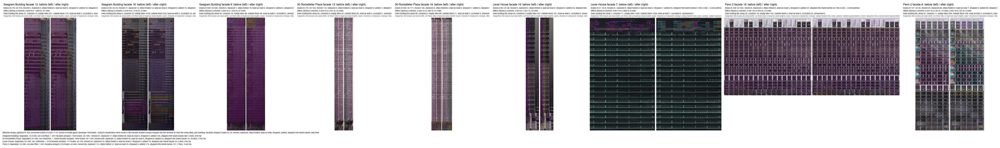
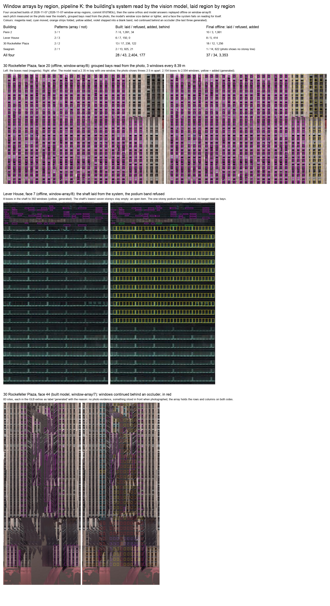
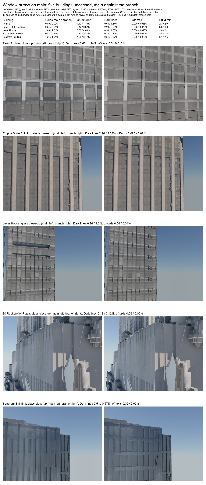
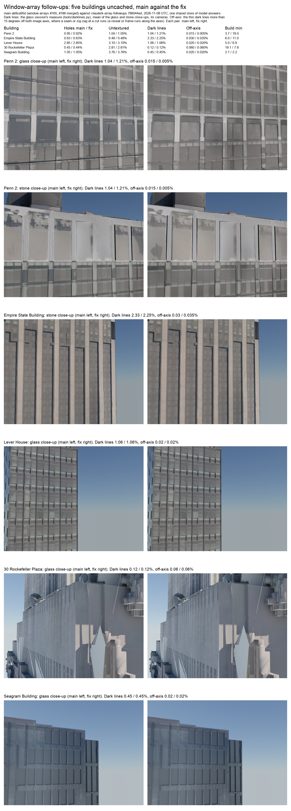

# Pipeline K: a window array per facade, inferred from the boxes (2026-11-06)

**Question.** The user looked at the Seagram Building's facade 6 (the window boxes from `sbFacadeLattice.windows.uv` over the
straightened photo) and said: with this much pattern input we should be able to infer an array. The upper half of that
facade is one clean grid (one column pitch, one storey pitch, one box size); the lower half's boxes sit off that grid and
oversized, because the window fit reads each band on its own from a dimmer part of the photo, the middle is read as
strips, and nothing afterwards checks a band's grid against the facade's. Then, on the first version: "we could do much
better at inferring patterns" — a site-by-site test left the dim bottom third patchy though the facade's pattern is obvious.

**Answer.** A new step, `pipeline-k/window-array.ts`, after the window fit and the facade reader's merge and before the
wall grammar, wall sheets and lattice. It fits one lattice per facade by consensus over every box, folds strips on
lattice columns into the array's cells, judges every lattice row and column by its sites together, and inside the rows and
columns that hold the array fills every empty site unless the photo contradicts a window there. On the Seagram's facade 6
every arrayed facade now reads 1.38 m columns and 3.65 m storeys from top to bottom; the lobby and the crown, where the
evidence stops, stay as read.

## 1. What the step does

- **The lattice.** The column pitch and phase from every box's centre (strips included: a strip stands in its column), the
  storey pitch and phase from the rows the single-site boxes form (rows weighted by their boxes). A pitch is found by a
  spacing histogram over the pairwise distances: each candidate pitch (1% steps, 0.8–12 m, never under the boxes' own size)
  scores the distances that are a whole number of it within a tolerance of 15% of the boxes' own size (their centres
  jitter by a fraction of a box, whatever the pitch), farther multiples counting less (`1/k`), and the smallest pitch that
  reaches three quarters of the best score is taken at its local peak: a multiple of the pitch scores about as much, its
  half about half, so the pitch itself is the smallest to reach the bar. The phase is the densest bin of the centres modulo
  the pitch, then the mean of that bin's members. The pitch is refined by least squares over the distances that fit it, the
  nearer multiples first, the farther ones as the estimate sharpens (`consensusPitch`, `consensusPhase`).
- **Tiers.** A contiguous run of at least 3 rows off the facade's row lattice (centre farther than 0.25 pitch from a site,
  or boxes of another size) is tried as a tier of its own: its own pitch and phase, kept only when its fit is clean (RMS
  under 0.12 pitch), its pitch differs from the facade's by more than 5% (else it is a drifted band, snapped instead), and
  the photo separates window from wall more clearly under it than under the facade's lattice over those rows (CIELAB
  distance between each site and the wall beside it, averaged; the tier must gain 10%). Numbers decide, never a name for
  what the tier is.
- **Each box.** By its distance to its nearest site (in pitches) and its size against the lattice box (the median of the
  boxes on a site): left as read only when it sits within 0.08 pitch of its site and within 15% of the lattice box's size;
  else moved onto its site as the lattice's box (snapped, its panes carried along) or, when its size was off by more than
  35%, replaced; both photo-inferred, since the photo had a box there (user direction, 2026-11-07: one array has one box,
  so the dim rows do not keep the varying heights of a bad reading). A second box on a taken site is dropped; a lattice
  that would drop a fifth of the boxes that way does not explain the facade, which is left as fitted. A box whose area is
  under 0.4 or over 3 times the lattice box's is not of the array: kept as read, taking no site (a small opening on a
  facade of strips, a doorway among windows). A box spanning more than 1.6 sites on an axis is a strip or a
  bay: on a facade read mostly as cells, a strip one column wide standing on a lattice column is folded into the cells it
  covers (photo-inferred; its panes go to the cell they lie in); a wider bay, or a strip on a facade read mostly as strips,
  is kept whole and its sites are taken.
- **The majority.** A facade holds an array only when at least 12 single-site boxes, and half of those of the array's
  size, sit on the lattice at its size. Else it is left exactly as fitted, with the reason in the note.
- **The extent and the empty sites.** Every lattice row and column the photo spans is judged by its sites together: it
  holds the array when a quarter of its sites hold a box, or, within 2 rows or columns of the boxes' own extent, when
  its sites on average show the contrast the neighbouring
  windows (within 3 rows) show against the wall beside them — a relative CIELAB test (the site's look less the wall's just
  left and right of it, projected on the members' contrast vector), so a dim part of the photo reads like a bright one.
  Inside the rows and columns that hold the array every empty site takes the lattice's box (generated): a site too dim to
  confirm on its own, or one the photo never reached, is filled on the array's evidence (user direction, 2026-11-07: "we
  are not using our abilities if we cannot infer that this is an array of evenly spaced windows all the same size"); a site
  is withheld only where the photo reads the opposite of a window (that contrast under minus a quarter of the windows'),
  something stood in front of it (occlusion mask, over 35%) or a bay covers it. Outside those rows and columns nothing is
  added. The confidence of an added site is its contrast share; of a moved one, its distance.
- **Blank bands** (user direction, 2026-11-07, relayed by the materials session: Penn 2's top storeys under the mechanical
  roof came out as a blank box with smeared window shapes while the grid below was clean). From a row or column that holds
  the array it steps on through contiguous blank rows and columns — their sites' texels mostly unreached (the uncovered
  mask) or featureless (`facade_<id>_featureless.png`: a smear its own repeats did not refill) — at its pitch and phase,
  each site `continued` (generated, with the reason in `array.continued.reason` and the extras), until a row or column the
  photo reads that does not hold the array (a louvre screen, a setback: the evidence changes), or the photo's edge. An
  unreached band at a photo's top edge is entered only below the structure's roof line (`groundY + heightM`, passed from
  the orchestrator as `envelopeTopY` and turned into the photo's first allowed row through the plane frame), never above
  it; a blank column is never continued sideways past the photo's reach, where no envelope says the wall goes on.
- **Panes.** A snapped box's own panes move with it; a replaced, folded or added box takes the pane layout of the nearest
  box on the lattice with panes.
- **Provenance and repeatability.** Snapped, replaced and folded boxes are photo-inferred; added ones are generated, in
  the window fit's `generated` list (so `sbFacadeLattice.windows.generated` carries them) and in
  `sbFacadeLattice.windows.array` (the lattice, the counts, the moved, replaced and folded boxes' UVs). The pre-array boxes
  stay in `window_fit.json` under `array.in` with every site's box, kind, confidence and residual (`array.sites`), so the
  step is repeatable: an entry already carrying this version is not inferred again, one carrying another is restored first.
  The run note `pipeline_k_window_array` reports per facade: boxes in, pitches and phases per tier, on, moved, replaced,
  folded, kept, added, dropped, the rows and columns holding the array, the input and output RMS in pitches, and why each
  empty site was not filled. On unless `SCRATCHBOX_K_WINDOW_ARRAY=0` or the node graph's `remesh.windowArray` is off.
- **Not done.** One column lattice per facade (a tier may have its own storey pitch, not its own column pitch); a wall sheet
  built from several facades carries no `array` extras (its windows come from the arrayed fit, but the sheet's node names
  no array); nothing is folded on a facade read mostly as strips.

## 2. Offline, on kept caches (the step alone, before any build)

Seagram, the window fit's boxes from the 2026-11-06 glass benchmark's main-side cache (`relief_orthos_k_dd7178e1f54a7a3d`):

| Facade | Boxes in | Column / storey pitch | On | Moved | Replaced | Strips folded | Kept as read | Dropped | Added | RMS in → out (pitches) |
|---|---|---|---|---|---|---|---|---|---|---|
| 6 (the user's) | 487 (71 strips) | 1.38 m / 3.66 m | 220 | 58 | 120 | 69 | 4 | 14 | 92 | 0.107 → 0.032 |
| 3 | 108 | 1.41 m / 3.66 m | 86 | 7 | 11 | 1 | 0 | 0 | 14 | 0.063 → 0.031 |
| 10 | 204 (58 strips) | 1.42 m / 3.63 m | 108 | 14 | 20 | 36 | 0 | 4 | 46 | 0.147 → 0.028 |
| 14 | 80 (19 strips) | 1.39 m / 3.66 m | 28 | 10 | 12 | 13 | 11 | 0 | 14 | 0.136 → 0.024 |
| 15 | 84 (17 strips) | 1.42 m / 3.56 m | 32 | 13 | 15 | 17 | 7 | 0 | 59 | 0.237 → 0.025 |

The other twelve facades are left as fitted: fewer than 12 boxes, or no majority (facade 0, read as 243 strips of many
heights; facade 8, 10 of 13 on the lattice).

30 Rock's low block (facade 0, 131 x 48 m, an ortho that merges several surfaces): 127 boxes of which 42 small ones are kept
as read (not of the 1.39 x 11.4 m strip array), 45 strips snapped, 18 replaced, 10 folded, 5 added; a narrow face (54, 6.7 m
wide, rows jittering 3.1–5.1 m apart) is left as fitted, "24 of 51 on the lattice: no majority".

Three things the first version got wrong, found on these caches and fixed before the builds:

1. A sloped scoring kernel let a doubled or tripled pitch, with a proportionally larger tolerance, outscore the pitch
   itself on jittery rows (facade 14 at 7.4 m, facade 3 at 11.6 m). Now a flat kernel and the smallest pitch at three
   quarters of the best score.
2. A site-by-site colour test (nearer the windows' colour than the wall's) rejected most empty sites on a curtain wall whose
   dark glass and bronze mullions are near one another in colour, and left the dim bottom third patchy. Now the relative
   contrast test and the row-and-column judgement above.
3. A run of rows with the facade's own pitch but a shifted phase passed as a tier (30 Rock facade 54); a small box was
   replaced by a full strip (30 Rock facade 0). Now a same-pitch run is drift, and a box far from the array's size is kept.
4. A tolerance proportional to the candidate pitch let a large pitch sweep up two or three of Lever House's 1.15 m rows at
   every multiple and outscore the true pitch (facade 11, the slab: 754 reader boxes on a perfect 1.16 x 1.46 m lattice,
   given 8.1 m rows and left as fitted for dropping 209). Now the tolerance is a share of the boxes' own size: the slab
   reads 1.159 m x 1.464 m, 689 boxes on the lattice, 59 moved, 12 added.
5. A blank band was entered sideways and above the array wherever it was featureless, which on the Seagram's facade 15 (an
   ortho that merges the tower with a neighbour's smeared wall) placed 524 sites on the neighbour. Now a blank run is
   entered only between two rows (columns) that hold the array, or up to the roof line.
6. A lattice read at a crown alone was carried down the whole facade: Lever House's long face (facade 4) had 85 reader
   boxes, 0.54 m tall, in the top 6 m of a 92 m slab, and every row below held the array on its contrast alone (glass
   bands do read as windows), giving 527 added sites at 0.83 m rows in tidy clusters that are nothing like the slab's
   3.7 m bands. Now a row or column holds the array on its contrast alone only within 2 rows (columns) of the boxes' own
   extent; farther away only its boxes count. Rows are also never nearer than the boxes are tall.
7. The facade reader's boxes come at fractional pixels, and a texel loop over a fractional box reads nothing (its indices
   fall between texels): every reader box's contrast was silently unread, so the rows held on occupancy alone and the
   empty sites were filled as "unreached". Now every box is rounded to whole texels on input (the overlay tool too, whose
   fractional strokes had been landing on the wrong colour channels).

## 3. Builds

| Building | Build | Facades arrayed | Boxes in | On | Moved | Replaced | Strips folded | Kept as read | Dropped | Added | Stepped into blank bands | Step time |
|---|---|---|---|---|---|---|---|---|---|---|---|---|
| Seagram Building | degraded, 10.6 min, run 4c52fba5 | 5 of 21 | 1159 | 1061 | 31 | 17 | 29 | 3 | 0 | 135 | 682 | 978 ms |
| 30 Rockefeller Plaza | degraded, 8.0 min, run 04ad2d4c | 23 of 68 | 1640 | 1109 | 469 | 12 | 28 | 3 | 8 | 54 | 14 | 1705 ms |
| Lever House | degraded, 6.3 min, run 7ed3094e | 5 of 19 | 171 | 104 | 42 | 10 | 4 | 3 | 3 | 73 | 24 | 294 ms |
| Penn 2 | degraded, 4.9 min, run 9841ff38 | 6 of 41 | 916 | 665 | 88 | 114 | 12 | 23 | 9 | 174 | 121 | 1543 ms |

All four built uncached on `feat/k-glass-openings` at 79356a68 plus this branch, run8 of 2026-11-07 (the branch was then
rebased onto that branch's tip cb53ba08, whose five commits key the reader's answers by the straightened photo, vote the
reader's windows as strips in the wall grammar and name the windows' source in the lattice extras; none touches the array
step) (the facade reader's accepted boxes merged into the window fit, then the array step), in `/Volumes/3DTESTING/scratchbox-ide/benchmarks/2026-11-06-window-array-glass/glass-array/<place>/` (kept caches, run notes, models). The runner's `result.json` carries a stale commit and run id from an earlier row of the checkout's ledger (a runner quirk, not fixed here); the run ids above are from each `tool_result.json`, the times from `run8.log`. Every build is degraded for the reasons the outside check and the survey already report on main (holes, an unsurveyed face), not for the array step. The busiest facades:

- Seagram Building facade 9: 630 boxes in, 1.534 m columns, storeys 3.645 m; on 592, moved 0, replaced 1, folded 16, kept 3, dropped 0, added 0, continued 0; rows holding 40, columns 16; RMS 0.037 → 0.022 pitches.
- Seagram Building facade 12: 279 boxes in, 1.699 m columns, storeys 3.646 m; on 279, moved 0, replaced 0, folded 0, kept 0, dropped 0, added 29, continued 0; rows holding 31, columns 10; RMS 0.014 → 0.014 pitches.
- Seagram Building facade 15: 126 boxes in, 1.669 m columns, storeys 3.624 m; on 125, moved 0, replaced 1, folded 0, kept 0, dropped 0, added 31, continued 0; rows holding 32, columns 5; RMS 0.033 → 0.02 pitches.
- 30 Rockefeller Plaza facade 18: 303 boxes in, 2.484 m columns, storeys 3.503 m; on 171, moved 126, replaced 3, folded 0, kept 0, dropped 1, added 4, continued 0; rows holding 58, columns 6; RMS 0.259 → 0.006 pitches.
- 30 Rockefeller Plaza facade 13: 275 boxes in, 2.531 m columns, storeys 3.504 m; on 164, moved 110, replaced 0, folded 0, kept 0, dropped 0, added 1, continued 0; rows holding 55, columns 6; RMS 0.194 → 0.011 pitches.
- 30 Rockefeller Plaza facade 14: 123 boxes in, 2.045 m columns, storeys 3.504 m; on 112, moved 3, replaced 1, folded 6, kept 0, dropped 1, added 0, continued 0; rows holding 57, columns 2; RMS 0.106 → 0.013 pitches.
- Lever House facade 16: 60 boxes in, 1.351 m columns, storeys 2.63 m; on 58, moved 0, replaced 0, folded 0, kept 0, dropped 0, added 34, continued 0; rows holding 34, columns 3; RMS 0.008 → 0.009 pitches.
- Lever House facade 7: 51 boxes in, 2.889 m columns, storeys 0.857 m; on 9, moved 31, replaced 8, folded 0, kept 2, dropped 1, added 26, continued 0; rows holding 7, columns 11; RMS 0.248 → 0.035 pitches.
- Lever House facade 3: 21 boxes in, 3.216 m columns, storeys 3.686 m; on 18, moved 3, replaced 0, folded 0, kept 0, dropped 0, added 0, continued 0; rows holding 3, columns 6; RMS 0.068 → 0.024 pitches.
- Penn 2 facade 16: 428 boxes in, 5.943 m columns, storeys 3.281 m; on 420, moved 0, replaced 0, folded 0, kept 5, dropped 0, added 22, continued 54; rows holding 26, columns 18; RMS 0.033 → 0.009 pitches.
- Penn 2 facade 9: 147 boxes in, 2.92 m columns, storeys 3.591 m, 0.952 m; on 45, moved 34, replaced 60, folded 0, kept 7, dropped 0, added 60, continued 39; rows holding 20, columns 11; RMS 0.168 → 0.024 pitches.
- Penn 2 facade 34: 112 boxes in, 6.007 m columns, storeys 7.18 m; on 78, moved 8, replaced 13, folded 0, kept 8, dropped 5, added 0, continued 14; rows holding 14, columns 7; RMS 0.122 → 0.019 pitches.

## 4. Sheet

Sheet: [k-window-array/2026-11-06-sheet.jpg](./k-window-array/2026-11-06-sheet.jpg) (also in the session notes folder as
`k-window-array-sheet.jpg`, with the per-facade overlays `k-window-array-<place>_<facade>.png`). The builds, their kept
caches and the overlays: `/Volumes/3DTESTING/scratchbox-ide/benchmarks/2026-11-06-window-array-glass/` (the main-base
builds of the first version, for comparison: `.../2026-11-06-window-array/`).

Left of each pair: the boxes as the window fit and the facade reader read them (magenta). Right: after the step — on their
site or kept as read (magenta), moved or replaced (cyan), strips folded into cells (orange), added (yellow), bays kept whole
(green).

**Spot counts** (a small vision model, Claude Haiku, counting on clean crops of the straightened photo against the boxed
result, told nothing about what the step should do; its counts are visual estimates):

- Seagram facade 9, four storeys mid-tower: 15 to 16 openings per storey read in the photo, 16 boxes per row drawn, the
  box edges on the mullion lines (the boxes sit on the glass, none on a pier); the boxes may start 15 to 30 px above each
  cell's top, reaching into the bronze band (low confidence at the crop's resolution).
- 30 Rock facade 18, seven storeys of a narrow stone face: 7 openings per storey, 7 rows of boxes; the three left columns
  on their openings; two columns (moved, cyan) about 37 px (0.6 m) left of their windows, two thirds on the pier: this face
  has a wider pier between its third and fourth window columns, and one translational lattice cannot hold both groups
  (a known limit: a second column phase per group would). One column is a strip the reader read whole, not split by storey.
- Penn 2 facade 16, the top: the washed-out storey under the parapet carries boxes at the same 12 columns as the storeys
  below (the direction's case); the top continued row starts about 25 px (1.9 m) inside the pale parapet strip, so the
  structure's scan height sits a little above the parapet line; the washed zone is split into three rows at the lattice's
  3.28 m pitch, with no edge in the photo to confirm the split (it is the array's, as intended).

Open items from these counts: an irregular pier breaks the single column lattice on a stone face (30 Rock 18); the
envelope is the scan's height, not the vector's, so a continued row can start inside the parapet (Penn 2 16); a facade
whose reader boxes cover only the crown (Lever House 7, the slab's long face read as 51 small boxes at the mechanical
band) stays at the crown, so the slab's bands are not boxed at all on that run — the reader's reading, not the array's.

## 7. Round three (2026-11-07): the array seeded from the photo, stepping as far as the photo shows it

### What the review found

The user's review of the run8 sheet ("architectural inference could be improved for detecting these windows") read at
full size:

- Lever House facade 7, the most regular facade in the set (twenty ribbon rows, a mullion every bay), got no window at
  all: the reader and the fit read only the crown's louvres, and the array fitted only to boxes.
- Penn 2 facade 9's lower slab, with visible windows, stopped two rows past the last box (`extendBeyond`).
- Seagram 16's pitch came from three rows (3.48 m against the building's 3.66 m) and its box from the median of a bad
  reading (0.93 x 2.26 m where the glass runs 2.5 m between the spandrels); the facade's middle columns, masked as
  occluded, were withheld, so the top rows had two columns.
- 30 Rock 13 and 18 kept five columns as strips and moved two onto a pier (the irregular-pier phase, still open).

The common thread: the module inferred from boxes alone. The fix with the most reach was a seed read from the photo
itself.

### The seed (`photoLattice`, `autocorrPeaks`, `foldCell`)

1. **Profiles.** The ortho's CIELAB per valid texel; its column and row lightness profiles (the mean L of each column
   and each row over the valid texels, NaN where under a tenth is valid).
2. **Candidate pitches.** Each profile's normalised autocorrelation over lags of 0.8 to 12 m (a running mean over twice
   the longest lag removed first, so a lit side shading into a dark one is not a period; at least three periods must
   fit); its local maxima at 0.15 or more, strongest first, up to six, each refined between texels by the parabola
   through its neighbours.
3. **The fold.** For a pair of pitches the photo is folded into one unit cell (every valid texel binned by its position
   modulo each pitch). The window is the interval on each axis darker than the rest of the cell (glass reads darker
   than the wall under the sky), the interval of 12 to 95% of the cell whose mean deviation, weighted toward a long
   interval, is largest, then grown to half-max; its centre is the phase, its length the window's size, and the window's
   mean colour less the rest of the cell's is the contrast.
4. **The pitch on each axis** is the candidate whose fold shows the window most clearly (the other axis at its
   strongest candidate), a sub-multiple (a half to an eighth) nearly as clear (90%) taken instead: a unit cell of two
   windows folds a little more clearly than one. The seed is clear when both pitches correlate (0.15) and the window
   stands out of the cell (CIELAB 6); it stands on its own when four rows and three columns show its contrast.

On the kept caches (orthos of run8), the seed read: Seagram 16 1.41 x 3.66 m, window 1.09 x 2.49 m (the correlation of
the storeys 0.83 over fifty of them); Lever House 7 8.54 x 3.75 m (the bay and the storey), window 5.85 x 1.53 m; Penn 2
16 2.97 x 3.69 m (the pane pitch and the storey, chosen over the 0.86 m transoms, which correlate more strongly but fold
less clearly: contrast 15.2 against 7.9); 30 Rock 18 and 13 3.50 m storeys and a 5.8 m column pitch (the pier rhythm in
pairs; the window columns at 2.5 m fold less clearly, 15.6 against 20.6, and are not a sub-multiple within 10%); Seagram 9
and 12, no clear seed (contrast 5.5 and 5.3; their boxes are good).

### The seed and the boxes reconciled

- **Agreement** (pitches within 5%): the boxes' pitch and phase stand, refined over every box; the seed's instead when
  the boxes occupy few rows (under four, or under a quarter of the rows showing the seed's contrast: Seagram 16's three
  rows against thirty-three). The window is sized from the fold at that lattice (a seed pitch a few percent off smears
  the fold over a tall facade into a narrow core), and only within 0.5 to 2.5 times the boxes' median size.
- **Sub-boxes.** Where the lattice's window spans the boxes (1.5 times their height or width: a window read as its
  halves, a pane and a spandrel read apart), the boxes standing in one site are merged into one window, the sub-boxes
  its panes (photo-inferred). A seed storey pitch a multiple of the boxes' whose window is no larger than theirs is the
  coarser reading of the same storeys and changes nothing (Seagram 12's 10.95 m, Penn 2 9's 7.16 m).
- **Outright disagreement:** the lattice whose evidence spans the wider extent wins (the seed's holding rows against the
  rows the boxes occupy, by 1.5): the seed over a crown's few rows (Lever House's louvres yield to the slab; the louvres
  are kept as read when of another size, or stand as a tier of their own), the boxes over a weak seed. Boxes that sit
  cleanly on their lattice (80% on it) never fold into a coarser reading of every other column (Penn 2 16's bays stand
  against the seed's pane pitch).
- **No boxes at all:** the seed alone is the lattice, every site generated. But the seed alone never replaces twelve or
  more boxes read with a window under half their median area: that darker interval is a band between the windows (30
  Rock's spandrels, darker than its reflective glass: facades 11, 21, 26 and 29 keep their 800 to 2,400 read boxes
  instead of gaining tiny boxes on the spandrels).

### The building's storeys (`buildingStorey`, `storeyOnFacade`; user direction, 2026-11-07: "we may need the context of the entire structure to infer the placements")

The floors are the building's, not one face's. After each facade's own pass, every arrayed facade's main storey lattice
(pitch and the windows' centre line) is converted to world height by its plane frame (`Y = centroid.y + axisT.y
(orthoTMax - y pixel)`) and weighted by the sites it holds (rows x columns, so a wide slab outweighs a narrow face of as
many rows); the pitch whose cluster of facades (within 5%) carries the most weight is the building's storey, its pitch
the cluster's weighted mean, its phase their circular mean. On the kept caches: Seagram 3.645 m from 5 facades (141
rows), 30 Rock 3.508 m from 19 (481 rows), Lever House 3.746 m from 3 (the 3.05 m a narrow face alone gave under a rows-only
weight was wrong), Penn 2 3.678 m from 3.

A second pass gives those storeys to the facades that lacked rows of their own (left as fitted, holding under four
rows, or a photo-only lattice whose storey is neither the building's nor a whole multiple of it, which read a transom or
a sill for a storey): a face's boxes take the building's pitch at the face's own phase (its boxes', or the fold's: the
building's phase is a mean over faces whose windows need not sit at one height, and gave Penn 2's facade 1 no box on a
site), a face with no row pitch takes it outright, and a face too short or too faint to correlate its own rows (fewer
than three periods: Lever House 3, three storeys tall; Penn 2 1, two) but whose columns correlate is folded at its
columns and the building's storeys, standing as a seed when that fold shows the window, one row of its own then enough.
Lever House 3 keeps its 21 read boxes on the building's 3.75 m (18 on, 3 snapped) where the face alone had snapped 12 and
dropped 9 on a 2.03 m seed; Penn 2 1 (32 boxes, two rows) stands on 3.68 m. A line of two sites is judged by both.

### The building's system read by the vision model, region by region (`building-system.ts`; user, 2026-11-07)

The passes above find periods; they do not understand a building ("not smart enough"). The top line the user then set:
**understand what an array is, what the pattern is, how it changes per region on a structure, and that some structures
have no arrays.** An array is a set of openings of one size repeating at one spacing across and one storey up; "no
array" (openings placed one by one, of differing sizes or spacing, or no openings) is an answer, never a failure to fill.

Before any face's array, every facade photo goes on one contact sheet (the facade reader's, `facade-reader-brief.ts`),
each cell told where its plane stands (facing, size, height above the lowest plane) and what the photo's own periodicity
measured there, and the facade reader's vision model answers, in numbers and one structural fact (never a type name):

- **patterns**: each distinct pattern of openings, `repeats` true (an array: storey, bay, windows per bay, window width
  and height, sill, in metres) or false (openings that do not form an array);
- **regions**: for every face, its bands bottom to top, each with its heights above the lowest plane and its pattern, or
  none (no openings): a base of shopfronts, a shaft of an array, a mechanical floor without openings, a crown of another
  array.

One call per building, kept in the model readings store by the sheet's pixels and the prompt. Checked on parse: storeys
2.2 to 9 m, bays 0.6 to 24 m, at most 8 windows a bay, every region naming a known pattern, confidence 40 or more; else
unused, with the reason.

A face the answer covers is run **region by region** (`inferRegions`): each band is cut from the photo with the boxes
whose centre lies in it. An array region lays its pattern's lattice through the plane frame (the pane pitch `bayM /
windowsPerBay` across; up, the storey with the window's centre at the region's bottom + sill + half the window, by
`Y = centroid.y + axisT.y (orthoTMax - y px)`), folds the photo at it and takes it only where the fold shows the window:
the model's pitches and sizes, the photo's phases (the model reads, the photo places; photo-inferred); the boxes refine it
as before. A region the fold contradicts is refused and reported. A region whose openings do not repeat, or with none,
keeps the openings read there exactly as read and gains nothing. A face the answer covers is not given the building's
storeys afterwards (its answer stands, array or not); a face off the sheet, or a building with no usable answer, reads
for itself as above. Tests: a face read by nothing gets its neighbour's 150 windows from one reading, kept for the next
build; a base of three odd openings is kept exactly under a filled shaft; a building read as having no arrays keeps
every box as read and adds none, however periodic its photo; an array read on a plain wall is refused; an unsure answer is
unused.

### One opening model, and what the system read replaces (MAIN's review, 2026-11-07)

MAIN's review of K found openings coming from overlapping readers (window fit, wall grammar, facade reader, window
array) that can disagree. On this branch the flow is:

1. The window fit and the facade reader read boxes.
2. The reader's boxes are merged into `window_fit.json` inside the zones it drew (`mergeReadings`).
3. The window array, with the system read, rewrites that same file.
4. Everything downstream reads that one file: the wall grammar and wall sheets (bays), the lattice (`facade-lattice.ts`:
   each window's recess and the panes it carries) and the material regions' glass (`paneGlass`, the panes the lattice
   carries).

So recess and glass already read one opening model, the arrayed `window_fit.json`. The twin reader on the finished
exterior draws nothing.

What the system read replaces and absorbs:

- **Replaces, on every face it covers:** the per-face lattice heuristics as the source of the lattice. The photo
  periodicity seed and the building storeys are now only the fallback for faces off the sheet or a building with no
  usable answer.
- **To absorb next: the facade reader's brief.** The brief is a second call on the same contact sheet of the same planes
  (its building sentences and its families of planes sharing a window system). Its families are the faces that share an
  array pattern in the system's answer, and its building text is the system's. So one call can serve both, with the
  reader's per-plane reads told the system instead of the brief. That leaves the per-building model calls where they
  were before this branch, at one.
- **Not done here:** the reader's files are not edited until the glass PR merges, so that absorption waits for the
  rebase. Until then the system read is one extra call per building, kept in the readings store.

### The extent, stepping

Each site is judged against the ring around it (the bands beside, above and below it, outside every box: a ribbon window
reads against its floor band, a punched one against the pier; the left-and-right test read Lever House's ribbons as
nothing against the equally dark panel beside them). From the rows and columns holding boxes (or, with none, the row and
column showing the contrast most clearly) the array steps outward row by row and column by column for as long as each
next one shows at least 0.3 of the windows' contrast (a lower bar than the 0.5 that establishes a row on its own, since
the array beside it is established and a storey in shade reads dim: Penn 2 9's lower slab reads 0.3 to 0.5), to the
photo's edge if it does; a blank run (unreached, occluded or featureless) is crossed and continued when the first row
read beyond it holds again (Seagram 16's occluded middle columns, between held columns on both sides); the walk stops at
the first read row that does not hold (Penn 2 9's podium, the ground floor at -0.02). A site inside the array that
something stood in front of is continued over (generated, counted), as the lattice continues over an occluded span, no
longer withheld. `extendBeyond` is retired.

### Offline, on the kept caches (`window-array/4`, before the builds)

| Facade | Before (run8) | Now | Source |
|---|---|---|---|
| Lever House 7 | 51 boxes, 26 added at the crown's 0.86 m rows, the slab empty | 296 added over 19 rows x 16 columns at 2.89 x 3.75 m, window 2.55 x 1.53 m, the 51 crown boxes kept | photo |
| Seagram 16 | 3.48 m rows from 3 rows, 75 added, 9 rows held | 3.66 m rows, 266 added over 34 rows (the occluded middle columns continued between the held ones), box 0.93 x 2.49 m | photo (agreement, few rows) |
| Penn 2 9 | 60 added, stopped two rows under the boxes | 130 added, the lower slab stepped to the podium | boxes |
| Penn 2 16 | 420 on, 22 added | 420 on, 4 added (the seed's pane pitch refused: clean boxes) | boxes |
| Seagram 9, 12; 30 Rock 18, 13; Lever House 16 | as run8 | as run8 (no clear seed, or the seed agreed and the boxes' window kept) | boxes |
| 30 Rock 11, 21, 26, 29 | left as fitted (835 to 2,446 boxes, no majority) | left as fitted: the seed's 0.78 m "window" refused as a spandrel | boxes stand |
| Lever House 3, Penn 2 1 (short faces) | left or mis-snapped | on the building's storeys, their boxes kept | boxes, rows from the building |

### Builds (`2026-11-07-window-array-regions`, run1, commit 87d7983c, `window-array/7`, uncached)

Four uncached builds, all finished degraded on their usual counts (holes 0.8 to 2.8%, generated 66 to 69%), $2.26 of
model calls in all. The vision model read a sensible system for every building in one call each:

| Building | Patterns read (array / not) | Array regions laid / refused | Windows added | Behind an occluder |
|---|---|---|---|---|
| Penn 2 | 3 / 1 (shaft curtain wall 3.7 x 2.97 m, end bays, louvre bands; storefronts) | 7 / 6 | 1,091 | 34 |
| Lever House | 2 / 3 (shaft 3.75 x 1.44 m, podium glazing; open ground, solid core, penthouse) | 6 / 7 | 150 | 0 |
| 30 Rockefeller Plaza | 2 / 2 (tower windows 3.5 x 2.35 m, narrow bays; storefronts, parapet band) | 13 / 17 | 238 | 122 |
| Seagram | 2 / 1 (curtain wall 3.65 x 1.41 m, low podium; lobby) | 2 / 13 | 925 | 21 |

The reading was right; the photo refused too many of its arrays. Replayed offline on the builds' own orthos and the
model's own answers (exactly reproducing the builds' counts first), three causes:

1. **The model's pitch taken as read.** A pitch a percent off drifts half a storey over a 60-storey face and the fold
   smears. Each pitch is now measured on the photo: its strongest autocorrelation peak within 8% of the model's
   (`measurePitch`). A 1D fold search was tried first and was too coarse (30 Rock 20: 45.72 px against the true 45.42).
2. **Grouped bays.** 30 Rock's windows stand in threes 2.5 m apart, a wider pier between the groups, every 8.39 m; the
   model read a 2.35 m bay with one window, and no single pitch fits (the sites drift in and out of phase, every row
   averages zero). Grouped bays are now measured from the photo (`groupedBay`) and the band warped across so its windows
   stand evenly (`bayWarp`, window interiors at their own scale), inferred there and warped back. Read on seven of 30
   Rock's faces at 8.38 to 8.46 m with three windows, two narrow faces at 5.85 m with two; never on a band under four
   storeys (a one-storey podium band read four uneven windows to a bay before that guard).
3. **No fallback.** A system lattice that showed its window in the fold but held no row or column returned the face
   unchanged; it now reads for itself (its own seed and boxes), the refusal kept in the report.

The fold in the system path also takes the model's window size and tries the window darker and lighter than the rest
of the cell. Seagram stays refused: its tile photo shows the mullions and no storey line at all (window and spandrel the
same bronze-dark), so the photo cannot place a window, and the refusal is the right answer.

| Offline on the builds' orthos | Laid / refused | Windows added |
|---|---|---|
| As built (`window-array/7`) | 28 / 43 | 2,404 |
| Pitch by autocorrelation, fallback | 27 / 44 | 2,211 |
| Final (`window-array/8`: and grouped bays, window size either sign, four-storey guard) | 37 / 34 | 3,353 |

By building (final): Penn 2 10 / 3 and 1,061; Lever House 8 / 5 and 414 (face 7's shaft 8 boxes to 392 windows); 30
Rock 18 / 12 and 1,256 (face 20 2,154 boxes to 2,554 windows, face 27 550 to 1,862); Seagram 1 / 14 and 622. Not yet
rebuilt end to end on `window-array/8`.

### On main after the glass, tile-seam and relief merges (2026-11-08)

Rebuilt uncached on main b2a41010 (glass #182, tile seams #185, measured relief #187) against #165 + #186 at dbfb7aeb.
All five buildings ran on each side, with load under 100. One store of model answers was shared by both sides, so they
read identical photos with identical answers (`2026-11-07-window-array-main`).

Dark lines are the glass session's measure (`tools/darklines.py`), the mean of its glass and stone close-ups from its
cameras. Off-axis is that measure's thin dark lines more than 15 degrees off both image axes. A seam, slit or zig-zag at a
cut runs that way; a reveal or frame runs along the axes.

| Building | Holes, main / branch | Untextured | Dark lines | Off-axis |
|---|---|---|---|---|
| Penn 2 | 0.89 / 0.92% | 1.13 / 1.10% | 0.66 / 1.14% | 0.000 / 0.015% |
| Empire State Building | 0.54 / 0.54% | 0.42 / 0.37% | 2.26 / 2.08% | 0.085 / 0.070% |
| Lever House | 2.83 / 2.84% | 3.08 / 4.00% | 0.96 / 1.00% | 0.060 / 0.040% |
| 30 Rockefeller Plaza | 0.44 / 0.45% | 2.73 / 2.81% | 0.13 / 0.12% | 0.060 / 0.060% |
| Seagram | 1.21 / 1.04% | 4.05 / 3.77% | 0.51 / 0.57% | 0.020 / 0.020% |

- **No seams added.** The off-axis share is equal or lower on four buildings and up 0.015 points on Penn 2. Where dark
  lines rise (Penn 2), they run along the axes: window frames and recess edges.
- **Lever House.** Main's two dark horizontal slots across the slab are gone; the grid runs on.
- **Seagram.** The scattered slits become the curtain wall's grid.
- **Empire State Building.** Close to main, slightly fewer dark lines. 30 Rock is equal; its close-up shows no windows.

Found and fixed during these runs:

- **Model-sized windows in full bays.** On Penn 2 the system laid the model's 1.72 x 1.8 m window in bays the reader's
  boxes fill at 2.6 m; they were drawn as notched dark recesses. The boxes read on the system's sites now set its window
  size and phase, and a fold of known window size centres it in its dark run.
- **Reader boxes moved.** The array snapped the facade reader's boxes onto an even lattice. On the ESB that broke the
  paired windows the wall grammar reads its bays from. The reader's boxes are now never moved or replaced (it is the
  primary source of windows, 2026-11-06).
- **Grouped bays at whole multiples.** A bay the model reads with several windows is now grouped when they stand unevenly,
  even when it is exactly k windows wide.
- **Speed.** The array's colour looks use cached CIELAB and skip masks: 30 Rock's array 178 s to 14 s with the same
  windows. The branch's 30 Rock build ran before this, at 23 min against main's 10.
- **Taken out after a regression.** A fit check and per-column offsets: on Penn 2 the fit check refused a working system
  lattice over mixed bay and half-bay boxes, and the face's own reading then laid two-storey windows.

**The reader varies between runs.** Two separate reads of the same ESB photos returned 838 and 622 windows on facade 43.
They turned its window strips from dark recessed glass into grey wall. Comparisons between checkouts must share the
model answers, or that variance swamps the change.

### Follow-ups after the merge (2026-11-08, `claude/k-array-followups`)

MAIN's review of the merged arrays named two problems. The first was a long dark horizontal line across Penn 2's glass
close-up, with a cracked pane in the band row. The second was Lever House's untextured share, 3.08 to 4.00%. Both sides
were rebuilt uncached: main ab9ca95d against the fix (786044ed), with one shared answer store
(`2026-11-08-array-followups`). Main's ESB build hit tile_refine's 900 s limit at load 45 and was retried.

| Building | Holes, main / fix | Untextured | Dark lines | Off-axis |
|---|---|---|---|---|
| Penn 2 | 0.95 / 0.92% | 1.04 / 1.05% | 1.04 / 1.21% | 0.015 / 0.005% |
| Empire State Building | 0.63 / 0.63% | 0.48 / 0.48% | 2.33 / 2.25% | 0.030 / 0.035% |
| Lever House | 2.85 / 2.85% | 3.10 / 3.10% | 1.06 / 1.06% | 0.02 / 0.02% |
| 30 Rockefeller Plaza | 0.45 / 0.44% | 2.81 / 2.81% | 0.12 / 0.12% | 0.06 / 0.06% |
| Seagram | 1.05 / 1.05% | 3.76 / 3.76% | 0.45 / 0.45% | 0.02 / 0.02% |

- **Penn 2's long line and cracked pane.** The facade reader drew the shaft's windows two storeys tall (7.2 m). The array
  folded each into two one-storey cells, and the lattice drew a wall band and recess edges through every one. The
  reader's boxes are now never folded either; only the window fit's strips are. Facade 11 went from 272 folded cells to
  none. On the glass close-up the line and the crack are gone: dark lines 1.30 to 0.91%. The stone close-up rises 0.77 to
  1.50%. There the louvre panels at the roofline, also drawn tall by the reader, stand whole and recessed, and their
  shadowed side reveal reads as a thin dark line. These lines run along the axes; the off-axis share falls 0.015 to
  0.005%, and holes 0.95 to 0.92%.
- **Lever House's untextured share.** The earlier attribution to the corner-join strips was wrong: the strips are
  textured. The rise was the seal: a 222 m² untextured cap at 93 to 94 m, closing the shaft's top rim over the roof
  scanned just below. A pass that left such caps out of the textured twin (`roof-caps.ts`) took Lever House from 4.00
  to 3.30% on the earlier models. On main ab9ca95d (the proud audit, #188) the cap no longer forms: Lever House is 3.10%
  on both sides, and the pass changed nothing on the five buildings. It was taken out (MAIN, 2026-11-08: only code that
  improves output is added). If the cap returns in a build, the pass comes back with that build as its proof.

### Open
- 30 Rock's branch build took 23 min (array 358 s before the speed fix, the building system 97 s, load 50 to 68).

- 30 Rock's pier rhythm is read as grouped bays in the system path (`groupedBay`); a face read without the system (its
  own photo seed) still takes the bay as one cell with one window and needs the same bay read.
- The end-to-end rebuild on `window-array/8` waits for the glass PR (#182) to merge, and for the machine's load to be
  under 100. MAIN is holding #182 over black diagonal zig-zags and dark outlines at the lattice/scan cut around rebuilt
  panels (ESB close-ups). Its dark-line measure in numbers.json went ESB 1.48 to 1.62 and Lever House 0.22 to 0.77, main to
  branch. This PR brings about 1,000 more recessed windows to that cut, so the rebuild carries the same measure, plus a
  close-up crop of the cut, to show that the windows add no seams.
  Rebase onto current main first: #185 (merged at 5d72aeb3) removes the tile caps and zips the rims by default, so K
  builds start from a different welded scan with fewer open edges at tile cuts. The comparison must be like for like.
- Lever House 7: the shaft's lowest seven storeys stay unfilled though the photo shows the same grid; the stepping stops
  there (not the grouped bays, which are not read on that face's shaft).
- The seed reads lightness only and takes the darker interval as the window; a facade whose glass reads lighter than
  its wall (a mirror wall under an overcast sky) gets no seed and stays with its boxes.
- A column stepped onto at the ortho's edge may lie on the neighbouring plane the ortho also shows (Seagram 12's last
  column): the plane's own extent is not read.
- After the rebase onto the glass branch: its lattice keeps the scan in a row's end cells whose own scan lies more than
  0.25 m behind the row's wall depth (a curving wall, the Flatiron prow; commits 3e245788, a9d558f1). The array can add or
  step windows to a wall's ends. Check that a generated window landing in such a kept-scan cell is dropped from the
  lattice's windows and panes, not drawn as glass over the scan, and that the array does not count it as laid. The tear
  audit's ray probe (every surface along a red pixel's ray, front or back and node) is the check to reuse.

## 5. Tests

`packages/core/test/pipeline-k-window-array.test.ts` (synthetic 30 x 60 m facades at a 3 x 4 m grid): the consensus pitch
against a noisy minority; a drifting, oversized lower half brought onto the upper half's array with the empty sites filled
(150 of 150, RMS under 0.03 pitch); two genuine tiers (4 m and 6 m storeys) kept, the base's own pitch winning on the photo;
an occluded span and unreached rows getting nothing, three flanked sites in a row filled; strips on lattice columns folded
and a faint row filled from the rows around it; a box of another size kept as read and a site that reads as wall left
empty; a facade with no majority grid left exactly as it was; `window_fit.json` rewritten once and not inferred twice.
With `staged-build-steps-graph`, `window-fit`, `pipeline-k-facade-reader`, `pipeline-k-twin-reader`,
`pipeline-k-material-regions` and `instruction-tool-drift`: 163 tests pass on Node 22.18; `npm run typecheck` clean.

## 6. Files

- `packages/core/src/node/3d-engine/staged-location/pipeline-k/window-array.ts` (new), its test, and
  `scripts/window_array_overlay.ts` (the before/after overlay from `window_fit.json` or a model's extras; `--infer` runs
  the step on a copy of a kept cache).
- `orchestrator.ts`: the step after the window fit and the reader's merge; `facade-lattice.ts`: `windows.array` in the
  extras; `window-fit.ts`: `regionLook` exported; `staged-build-steps.ts`: the step and its switch.
