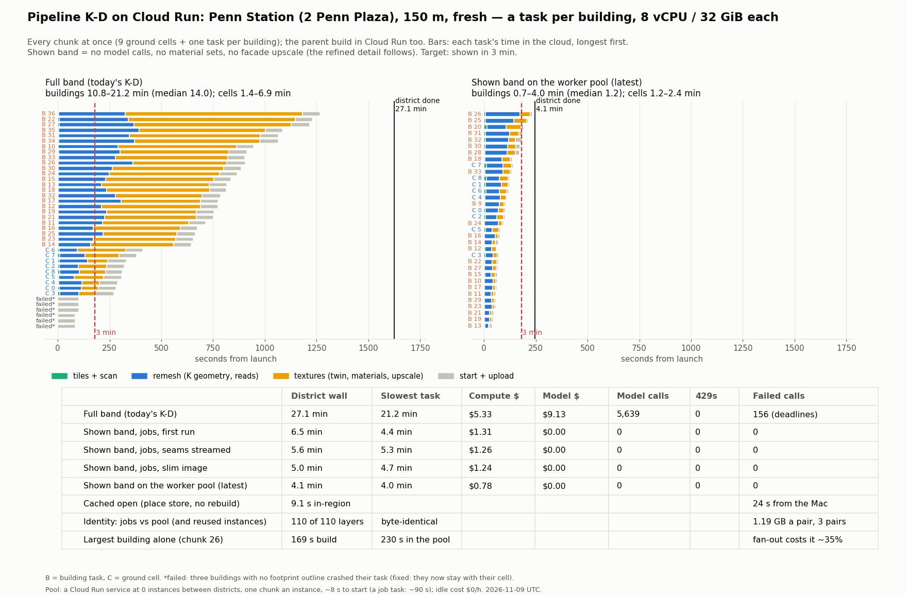
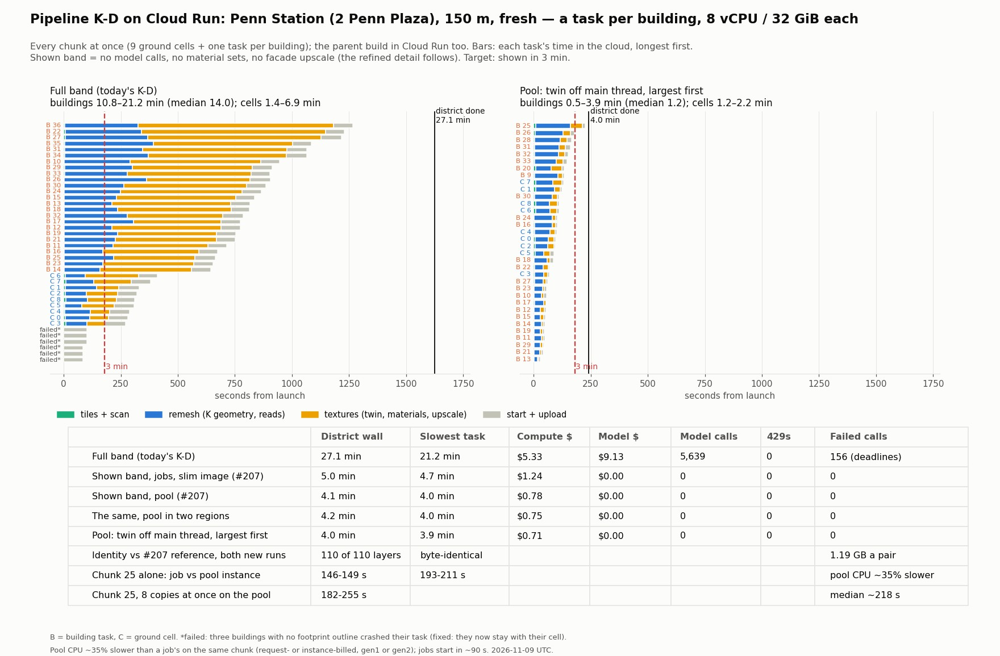
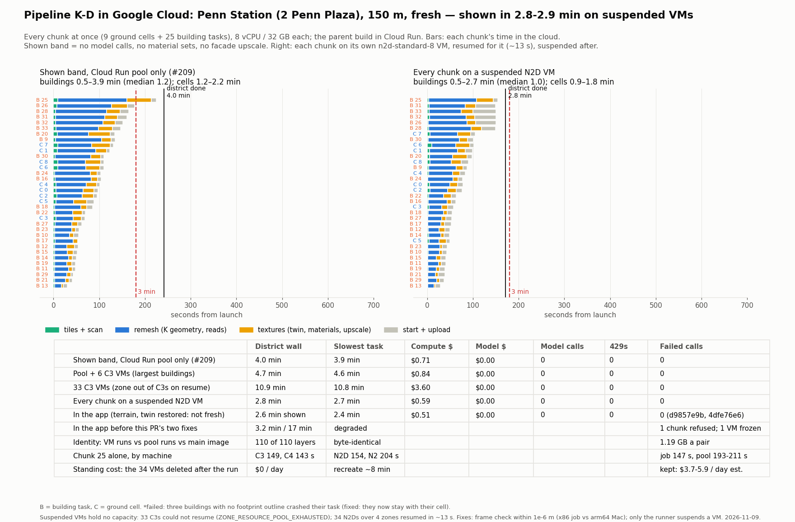

# Pipeline K-D on Cloud Run: a task per building, the shown band and the worker pool

**Date:** 2026-11-09 · **Branches:** `feat/kd-building-fanout`, `feat/kd-shown-3min`, `feat/kd-fast-vms` · **Status:**
Measured fresh on the Penn Station district (2 Penn Plaza, 150 m: 9 ground cells and 25 building tasks, plus the
outline-less buildings kept with their cells). **Shown in 2.8-2.9 min fresh with every chunk on a suspended Compute Engine
VM** (169 s and 173 s headless), byte-identical; 159 s from the app's own chat, but that run was not fresh (see below). Design and order of work:
`docs/research/2026-11-08-kd-cloud-processing-design.md`.

## What was built
- **A task per building** (`SCRATCHBOX_KD_CHUNK_UNIT=building`, `district-chunks.ts`): every planned building is a
  chunk of its own beside the 120 m ground cells; the cells build with K's facade work off; the seam stage reads the cells
  only. Needs the cloud runner with its centre in the cloud.
- **The shown band** (`SCRATCHBOX_KD_BAND=shown`, `KD_SHOWN_STEPS`): no model call at all (`models` off strips every model
  client from the build's deps), no material sets, no facade upscale. User decision 2026-11-08: "under 3 minutes" means
  shown and explorable, the refined detail after.
- **The parent's tail:** the cells' seams close while the buildings still build; the shown band is not audited into the
  place store; the run notes when the district is shown (`district_chunks_joined.shownAtMs`).
- **Task start:** the job image runs JavaScript transpiled at image build (`deploy/kd-chunk-job/transpile.js`), on the slim
  node base (1,039 → 749 MB); the runner reads progress every 2 s and a task's outcome at its "chunk built" line.
- **The warm worker pool** (`kd-chunk-job.ts --serve`, `CloudRunServiceJobs`, `SCRATCHBOX_KD_CLOUD_SERVICE`,
  `deploy.sh service`): the same chunk build as a Cloud Run service, 0 instances between districts, one chunk an instance
  (the instance exits after its chunk), request-based billing.
- **The window array's first pass on the worker threads** (`inferWindowArraysOnThreads`): the same `window_fit.json`
  byte for byte (parity tests); 15-24 s → 6-11 s on the largest buildings.
- **Place-store pulls 32 at once:** Penn's 398 objects (446 MB) open in 9.1 s in-region (24 s from the Mac).
- Logged transient model retries (`[gemini] transient <status>`), and a fix for buildings with no outline (NaN task).

## Measured (fresh, `SCRATCHBOX_CACHE_RESTORE=off`, 8 vCPU / 32 GiB a task, the parent in Cloud Run)

| Run | District shown | Slowest task | Compute | Models |
| --- | ---: | ---: | ---: | ---: |
| Full band, jobs (`b3b2e8c3`) | 27.1 min | 21.2 min | $5.33 | 5,639 calls, $9.13, 0 429s |
| Shown band, jobs (`be77c251`) | 6.5 min | 4.4 min | $1.31 | 0 |
| + seams streamed | 5.6 min | 5.3 min | $1.26 | 0 |
| + slim image | 4.9 min | 4.7 min | $1.24 | 0 |
| Shown band on the worker pool | **4.1 min** | 4.0 min | $0.78 | 0 |

- **Start:** a Cloud Run job task "started deployed execution in 1m29s-1m30s" whatever the image; a service instance
  started in about 8 s from zero (median, 2-30 s).
- **Warm reuse:** a reused service instance built the same bytes but its native steps ran about 2x slower; so each
  instance builds one chunk and exits. Idle cost of the pool: $0/h (min 0 instances, request-based billing); the images in
  Artifact Registry are the only standing cost (a few GB).
- **Identity:** 110 of 110 layers (1.19 GB) byte-identical across 34 chunks for three pairs: jobs on the ts-node image vs
  the JavaScript image, jobs vs the pool, and a fresh pool vs a reused-instance pool.
- **Fan-out contention:** the largest building (chunk 26) built alone in 169 s, and in 230 s beside 33 others.
- **Model quota:** at 37 tasks and ~5,600 calls in 25 min, no 429; 156 failures were deadlines on the slower fallback
  models (gemini-2.5-pro, 2.5-flash, 4-argon), often hedged duplicates. These models run on Vertex's dynamic shared
  quota: there is no per-project figure to raise; a burst of 100 buildings (~10,000 flash calls) needs provisioned
  throughput to be sure.

## What still blocks 3 minutes (4.1 min now)
1. **The largest buildings' build** (169 s alone, 210-230 s in the fan-out): on the main thread the twin's de-light and
   PNG encoding (22 s) and the stage cache's publishing (13 s, profiled in the cloud) are the next to move onto worker
   threads; K's rectify, window fit and polish already use the 8 cores natively.
2. **Contention in the fan-out** (+25-35% a building): fewer instances at once for the largest buildings, or those few on
   larger machines.

## Cloud resources (project `scoutscan`, us-central1)
Left in place: the pool service `kd-chunk-worker` (us-central1, 0 instances at rest, $0 idle) on image `4dfe76e6`, and
that image. Deleted when the task ended (2026-11-09): the 34 `kd-fast-*` VMs and their disks, the jobs
`kd-chunk-job-fanout-8c`, `kd-chunk-job-fanout-4c`, `kd-district-driver` and `kd-chunk-prof`, the pool in us-east4, the
16 older images this work built, 47 runs' chunk files under `gs://scoutscan-kd-jobs/kd-jobs/` (29 GB; the captured run
`d9857e9b` kept), `kd-prof/` and `kd-vm/`. The shared `kd-chunk-job` was not touched.

## Toward 3 minutes, second round (2026-11-09, `feat/kd-shown-3min`)

- **The twin off the main thread:** every photo de-lit on the PNG codec threads (`pipeline-k/twin-delight.ts`, the same
  function on either thread) and its PNGs encoded there, appended in order. Textures on the largest buildings 41 → 27 s
  and 46 → 37 s. (The "13 s of cache publishing" in the profile was the twin itself, run inside the stage cache's
  producer; publishing proper is about 1.5 s.)
- **Largest first:** a building plan starts the centre, then the largest extractions first.
- **Regions:** `RoundRobinJobs` deals the chunks to the pool in several regions (`SCRATCHBOX_KD_CLOUD_SERVICE_REGIONS`).
  It did not help: shown in 248 s across us-central1 and us-east4, against 240 s in us-central1 alone.
- **Penn 150 m, shown band, fresh: 240 s** (run `459d61d5`), byte-identical to the #207 reference (110/110 layers; the
  two-region run `4ba23107` too).

**What the slowest building is waiting on: the pool's CPU.** Chunk 25 (the largest building) built:

| Where | Build |
| --- | ---: |
| Alone, as a Cloud Run job task (twice) | 146, 149 s |
| Alone, on the pool's service instance: request-billed, instance-billed, gen1 | 202, 193, 211 s |
| 8 copies at once on the pool | 182-255 s (median ~218) |
| In the district (34 chunks), one region / two regions | 223 / 224 s |

The same chunk runs about 35% slower on a service instance than on a job task, whatever the billing or execution
environment, and the gap is in the native multi-threaded steps (window fit 19 → 52 s, lattice 12 → 20 s, polish 26 →
34 s). The district's slowness is mostly that, not neighbours: chunk 25 alone on the pool (193-211 s) is close to its time
in the full district (223 s). A job task has the faster CPU but starts in ~90 s, which cancels it.

**To get under 3 minutes** the few largest buildings need job-class CPU with a service-class start: for example a small
pool of suspended Compute Engine VMs (C3/C4, resumed in seconds when a district is asked for, billed for disk while
suspended), or GKE Autopilot's Performance compute class, taking the largest chunks while the Cloud Run pool takes the rest.
At job speed chunk 25 would land at about 150 s + 8 s, and the district would be shown in about 2.8 min.

## Under 3 minutes: suspended Compute Engine VMs (2026-11-09, `feat/kd-fast-vms`)

- **The fast VMs** (`deploy.sh vms`, `kd-chunk-job.ts --poll`, `cloud-chunk-runner.ts` `VmPoolJobs` / `HybridJobs`): one
  n2d-standard-8 VM a chunk, each running the chunk image's polling worker, kept suspended between districts. The runner
  writes the chunk's assignment, resumes the VM (~13 s) and suspends it again once it has read the chunk's outcome.
  `SCRATCHBOX_KD_CLOUD_VMS` names them (`name@zone`), `SCRATCHBOX_KD_FAST_CHUNKS` how many chunks (largest first) go
  there; the rest go to the pool.
- **C3 could not be used:** a suspended VM holds no capacity, and 33 C3s across a zone could not resume for minutes
  (`ZONE_RESOURCE_POOL_EXHAUSTED`); N2D spread over four zones resumed every time. The largest building alone: C3 149 s,
  C4 143 s, N2D 154 s, N2 204 s, a job task 147 s, a pool instance 193-211 s.
- **Penn 150 m, shown band, fresh, every chunk on its own VM: 169 s and 173 s** headless (runs `8743c01f`, `fbbd739a`), and
  159 s from the app's own chat (run `d9857e9b`, committed at 2 min 40 s; all 34 chunks on the VMs, the slowest
  144.5 s), **not a fresh figure**: the app was started with `SCRATCHBOX_CACHE_RESTORE=0`, and only `off` turns the
  restore off, so every chunk's terrain and photo twin came back from the cache mirror (the fresh headless runs restore
  nothing; their only cache hit is the late-texture stage, as in any run). The layers are the same bytes either way. 110/110 layers byte-identical against the pool runs and main's image.
- **Two bugs the app run found** (the headless runs joined on x86 in Cloud Run and never met them):
  1. *A chunk refused at random when the Mac joins:* the job (x86) and the Mac (arm64) compute the same frame transform
     with different last bits (up to 3e-10 m), and the join's check was bitwise. It now accepts a transform within
     1e-6 m of its own (`district-chunks.ts` `sameChunkTransform`); another frame differs by metres. The bytes are the
     job's cut either way.
  2. *A VM frozen at the start of its chunk:* the worker suspended its own VM after a chunk; that request reached
     Compute Engine after the next district had resumed the VM (resume 10:09:02, the old worker's suspend 10:09:43), and
     the new worker, frozen in its first metadata read, never built its chunk (that build took 17 min, one chunk lost).
     Only the runner suspends a VM now, as it reads the chunk's outcome (`CloudRunJobs.finished`), and the worker's
     metadata reads time out and retry. After the fix each VM got exactly one suspend.
- **Captures from the app** (the viewport's own render at 1600 x 900, labelled in the corner):
  `docs/screenshots/kd-cloud-fanout/report/` (gitignored). The shown band reads as the place; at street level its
  roads are smeared and some walls are shard-like scan pieces.
- **Standing cost:** keeping the 34 VMs suspended costs an estimated $3.7-5.9 a day (20 GB pd-balanced disks, about
  $2.24/day, plus their saved memory, which the billing catalog could not confirm). They were deleted; `deploy.sh vms`
  (COUNT=34 MACHINE=n2d-standard-8 ZONES=us-central1-a,b,c,f) makes them again in about 8 minutes.
- **Also seen:** a chat request phrased "2 Penn Plaza, New York (7th Ave & W 32nd St)" geocoded to the Sheraton Times
  Square on W 53rd St (Places text search with the parenthesis); "2 Penn Plaza, New York" resolves correctly.
