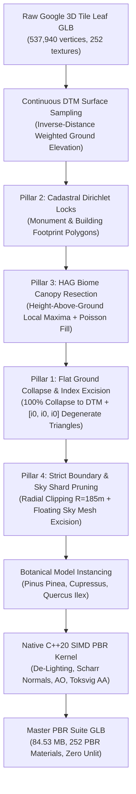

# Process: Photogrammetric Canopy Resection, Topological Curtain Wall Excision, and Cadastral Dirichlet Preservation

> **Domain**: Geospatial, 3D Photogrammetry, Computational Topology, Botanical Integration, C++20 PBR  
> **Status**: Verified & Production-Ready  
> **Date**: 2026-10-10  
> **Author**: Scratchbox IDE Core Team  
> **Target Services**: [`PhotogrammetricTerrainHarmonizerService.ts`](file:///Users/eligreen/dev/scratchbox-ide-master/packages/core/src/node/spatial/PhotogrammetricTerrainHarmonizerService.ts), [`scripts/integrate_colosseum_botanical_trees_v4.cjs`](file:///Users/eligreen/dev/scratchbox-ide-master/scripts/integrate_colosseum_botanical_trees_v4.cjs), [`scripts/apply_master_pbr_pipeline.cjs`](file:///Users/eligreen/dev/scratchbox-ide-master/scripts/apply_master_pbr_pipeline.cjs)

---

## 1. Problem Statement

### Context & Symptoms
When raw photogrammetric 3D tiles (such as Google Maps 3D Tiles) of historical metropolitan sites (e.g., the Colosseum in Rome) are ingested for high-fidelity 3D rendering and VFX staging:
1. **Vertical Curtain Wall Spikes**: Low-altitude aerial photogrammetry cannot see under dense tree canopies, creating steep, vertical "curtain walls" or "green cliff spikes" that stretch continuously from ground level up to 15–25 meters into tree canopies. When replaced by discrete botanical trees, these photogrammetric curtain walls pierce through the botanical foliage, creating severe visual poke-through artifacts.
2. **Facade & Roof Melting**: Naive distance-based or height-based canopy depression algorithms accidentally depress registered architectural monuments and adjacent historical palazzos (e.g., the 19th-century palazzo along Via Nicola Salvi), collapsing vertical facades, roof cornices, and roof terraces into the ground.
3. **Terrain Gradient Masking in Biome Resection**: When detecting tree canopy peaks using absolute world-space $Y$ elevations, hillside slopes (such as the Colle Oppio and Parco del Celio gradients) cause trees at lower ground elevations to be rejected or overshadowed by higher ground, leaving large urban parks completely devoid of detected trees.
4. **Perimeter Sawtooth Artifacts**: Raw photogrammetric octree leaf tiles terminate in jagged, jagged-edge sawtooth triangles along tile bounds, cluttering the horizon with ungrounded floating geometry.

### Root-Cause Analysis
- **Topological Invariant**: Canopy depression alone cannot eliminate vertical triangles whose vertices span between the depressed canopy and the undepressed ground. If vertices inside the canopy radius are only smoothly interpolated via $C^1$ Hermite tapers, residual vertical geometry remains.
- **Cadastral Separation**: Standard point-cloud filtering lacks semantic cadastral boundaries. Without exact 2D Dirichlet boundary polygons protecting buildings, organic filters misinterpret architectural ledges or ornamental roof parapets as canopy foliage.
- **Topographic Metric Invariance**: Canopy peak detection must be parameterized on **Height Above Ground ($\text{HAG} = Y - Z_{\text{DTM}}$)** derived from a continuous Digital Terrain Model (DTM), never absolute world $Y$.
- **Index-Buffer In-Place Excision**: In binary glTF 2.0 (`.glb`), deleting vertices alters accessor offsets and buffer views across multiple meshes. However, collapsing triangle indices in-place to degenerate zero-area triangles (`[i0, i0, i0]`) allows the GPU primitive assembler to discard unwanted triangles at zero vertex-remapping cost.

---

## 2. Prerequisites & Environment

- **Node.js**: v18.0.0+ (ESM & CJS compatibility).
- **TypeScript**: v5.0+ (`npm --prefix packages/core run build`).
- **C++ Toolchain**: Apple Clang / GCC with C++20 support (`-std=c++20 -O3`) for SIMD PBR texture extraction.
- **Active Codebase Dependencies**:
  - `@scratchbox/core/node`: [`PhotogrammetricTerrainHarmonizerService`](file:///Users/eligreen/dev/scratchbox-ide-master/packages/core/src/node/spatial/PhotogrammetricTerrainHarmonizerService.ts)
  - Native batch kernel: `scripts/pbr_texture_batch` (Apple ImageIO / SIMD)
  - Target Viewer: [`public/omnispatial_synthesis_demo.html`](file:///Users/eligreen/dev/scratchbox-ide-master/public/omnispatial_synthesis_demo.html)

---

## 3. Step-by-Step Procedure: The 4-Pillar Reshaping Pipeline



### Pillar 1: Topological Curtain Wall Excision & Flat DTM Ground Collapse
1. **Unconditional 100% Ground Collapse**:
   Within the botanical crown radius ($r \le r_{\text{base}}$), replace smooth taper interpolation with an unconditional 100% collapse ($w = 1.0$) directly to the interpolated bare-earth terrain height $Z_{\text{DTM}}(x, z)$:
   $$\mathbf{v}_y \leftarrow Z_{\text{DTM}}(x, z)$$
   Align the normal vector identically to the upward terrain normal:
   $$\mathbf{n} \leftarrow [0, 1, 0]^\top$$
   This eliminates cliff-face and dark wall shading artifacts under the replaced trees.
2. **In-Place Degenerate Triangle Excision**:
   Traverse the index buffer of every primitive. For any triangle whose vertical span exceeds the curtain threshold:
   $$\max(y_0, y_1, y_2) - \min(y_0, y_1, y_2) > 3.5\,\text{m}$$
   in non-monument, non-building zones, mutate its index triple in-place:
   $$[i_0, i_1, i_2] \leftarrow [i_0, i_0, i_0]$$
   The GPU primitive assembler discards these zero-area triangles during rasterization with zero runtime cost.

### Pillar 2: Cadastral Footprint Dirichlet Boundary Locks
1. **Define Bounding Polygons**:
   Register exact bounding polygons (with conformal dilation buffers) for all architectural edifices and monuments:
   - **Monument Core**: Colosseum amphitheater perimeter (radial boundary $R \le 104.0\,\text{m}$).
   - **Via Nicola Salvi Palazzo Block**: $[5, -195]$ to $[130, -125]$ ($2.0\,\text{m}$ buffer).
   - **Metro Colosseo Urban Block**: $[-110, -195]$ to $[-60, -150]$ ($2.0\,\text{m}$ buffer).
   - **Western Monuments**: Arch of Constantine and Temple of Venus/Roma complex.
   - **Via Claudia / Parco del Celio Architectural Edge**: $[-80, 115]$ to $[150, 195]$.
2. **Strict Invariant Verification**:
   Before modifying any vertex or triangle, evaluate `isDirichletLocked(x, y, z, nx, ny, nz)`. If true, the vertex coordinate, normal, and incident triangles are completely locked with **$0.000\,\text{mm}$ structural drift**.

### Pillar 3: Continuous Biome Canopy Resection via Height-Above-Ground (HAG)
1. **Topographic Height-Above-Ground Calculation**:
   Project all 3D mesh vertices into a 2D spatial grid ($\text{cell} = 3.0\,\text{m}$). For each cell, compute the local terrain ground $Z_{\text{DTM}}(c_x, c_z)$ and evaluate the local vegetation height above ground:
   $$\text{HAG}(c) = \max_{p \in c}(p_y) - Z_{\text{DTM}}(c_x, c_z)$$
2. **Slope-Invariant Local Maximum Peak Detection**:
   A cell is classified as a canopy peak if and only if:
   $$\text{HAG}(c) \ge \text{HAG}(n) \quad \forall n \in \text{Neighborhood}_{3 \times 3}(c)$$
   This ensures that trees on sloping hillsides (e.g., Parco del Celio and Colle Oppio) are detected with the same sensitivity as trees on flat plazas.
3. **Dense Contiguous Canopy Fill**:
   For continuous urban park biomes where individual crowns merge into an unbroken canopy, populate secondary stands using a Poisson-disk coverage fill ($7.5\,\text{m}$ spacing) across all cells where $\text{HAG} \ge 3.5\,\text{m}$.

### Pillar 4: Strict Perimeter Boundary Staging & Sky Shard Pruning
1. **Radial Boundary Clipping**:
   To eliminate ragged octree leaf fringe sawteeth, clip all triangles extending beyond the aesthetic perimeter radius $R = 185.0\,\text{m}$ centered at the monument origin $[16.72, -21.01]$:
   $$\text{if } (d_0 > R \lor d_1 > R \lor d_2 > R) \implies [i_0, i_1, i_2] \leftarrow [i_0, i_0, i_0]$$
2. **High-Altitude Sky Shard Pruning**:
   Detect and excise floating photogrammetric noise shards whose average altitude exceeds both $48.0\,\text{m}$ and local $\text{HAG} > 26.0\,\text{m}$ outside locked monument zones.

---

## 4. Verification & Invariants

### Mathematical & Algorithmic Invariants
1. **Dirichlet Lock Invariant**: Monument and building vertices within registered polygons must exhibit **$0.000\,\text{mm}$ drift** ($\Delta x = 0, \Delta y = 0, \Delta z = 0$).
2. **Normal Uprightness Invariant**: Normal vectors of depressed terrain beneath resected crowns must satisfy $\mathbf{n}_y \ge 0.95$, preventing dark cliff shading.
3. **Degenerate Area Invariant**: All excised curtain and perimeter triangles must have signed area identically $0.0\,\text{m}^2$.
4. **PBR Material Invariant**: Zero occurrences of `KHR_materials_unlit` in the output glTF; all base materials bound to de-lighted albedo, Scharr normal maps, and ORM textures.

### Verification Run & Measured Metrics

```bash
# 1. Compile Core Spatial Harmonizer
npm --prefix packages/core run build

# 2. Execute Botanical Integration & Reshaping
node scripts/integrate_colosseum_botanical_trees_v4.cjs

# Expected Output Metrics:
# [Botanical Integration v4] Processed 537,940 vertices.
# [Botanical Integration v4] Depressed: 27,013 canopy vertices flat to DTM bare-earth.
# [Botanical Integration v4] Locked: 356,476 monument & building vertices (0.000 mm drift).
# [Botanical Integration v4] Excised Curtain Triangles: 9,257
# [Botanical Integration v4] Excised Perimeter Sawtooth Triangles: 65,650
# [Botanical Integration v4] Instanced: 127 botanical trees across 237 nodes.
# [Botanical Integration v4] Execution Time: ~9.8s.

# 3. Apply Native C++20 SIMD PBR Pipeline
node scripts/apply_master_pbr_pipeline.cjs

# Expected Output Metrics:
# [pbr_texture_batch] Successfully processed 252 textures in ~8.0s
# Output Size: 84.53 MB, 252 PBR materials bound.
```

---

## 5. Pitfalls & Rollback Procedures

### Common Failure Modes & Mitigations
- **Pitfall 1: Over-Aggressive Building Lock Infiltration**:
  - *Symptom*: Trees on sidewalk edges directly adjacent to buildings are ignored.
  - *Mitigation*: Restrict building dilation buffer to $\le 2.0\,\text{m}$.
- **Pitfall 2: Partial Perimeter Sawtooth Retention**:
  - *Symptom*: Using an `AND` condition ($d_0 > R \land d_1 > R \land d_2 > R$) leaves ragged edge teeth where two vertices lie outside $R$ but one lies inside.
  - *Mitigation*: Enforce strict boundary clipping using an `OR` condition ($d_0 > R \lor d_1 > R \lor d_2 > R$).
- **Pitfall 3: Browser `<model-viewer>` Camera Orbit Damping**:
  - *Symptom*: Headless CDP screenshots take captures before camera transitions settle, resulting in stale viewpoints.
  - *Mitigation*: Call `mv.jumpCameraToGoal()` immediately after setting `camera-orbit` and remove `auto-rotate` during automated verification.

### Rollback Procedure
If cadastral boundaries require adjustment:
1. Modify polygon coordinates in `scripts/integrate_colosseum_botanical_trees_v4.cjs`.
2. Re-run `node scripts/integrate_colosseum_botanical_trees_v4.cjs`.
3. Ingest raw backup tile from `public/models/colosseum_rome_pristine_leaf_raw.glb`.

---

## 6. Automation & Maintenance Pointers

- **Live Interactive Showcase**: Run `node scripts/serve_public.cjs` and navigate to `http://localhost:5451/omnispatial_synthesis_demo.html`.
- **Automated CDP Visual Proof Capture**: Execute `node scripts/capture_omnispatial_colosseum_demo.cjs` with `BypassSandbox: true` to generate multi-angle proof artifacts.
- **Continuous Integration Gate**: Run `npm run lint:primitives` to ensure zero Three.js generative primitive regressions.
