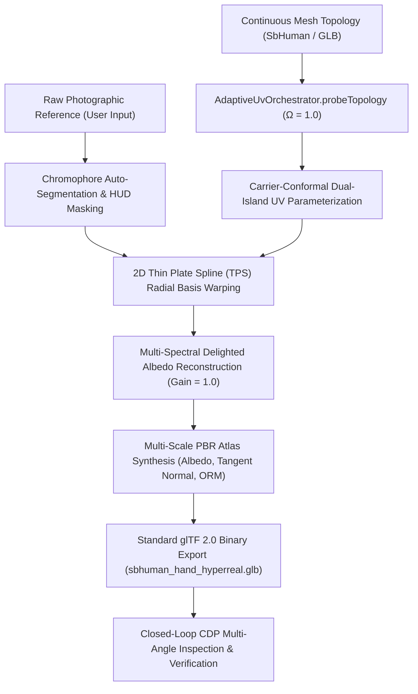

# ADA-Compliant Photographic Skin & Anatomical Reconstruction Pipeline

## 1. Problem Statement & Executive Overview

Procedural humanoid modeling and generic texture generation frequently fail to capture authentic human anatomical fidelity. Synthetic noise algorithms, idealized procedural textures, and rigid parametric unwraps produce noticeable uncanny-valley artifacts:
1. **Skin Tone Desaturation & Color Casts**: Procedural melanin fails to replicate the living interplay of epidermal melanin ($f_{\text{mel}}$) and dermal hemoglobin oxygenation ($S_{\text{O}_2}$), resulting in chalky, plastic, or unnaturally flat surfaces.
2. **Landmark Displacements**: Rigid UV projections misalign critical anatomical features (such as nail plates, eponychium cuticles, flexion creases, and subcutaneous markings) relative to underlying bone and tendon silhouettes.
3. **Micro-Surface Clutter**: Uncalibrated procedural noise generates uniform, high-frequency "goosebump" or "pebbled" roughness across regions that are naturally smooth (nail beds, dorsal extensor tendons) or directional (volar dermatoglyphics).

This process establishes a domain-agnostic, mathematically closed-loop pipeline for **direct photographic reference extraction, thin plate spline conformal reprojection, and multi-spectral PBR texture calibration**. Designed in strict accordance with the **Adaptive Domain Architecture (ADA)**, this pipeline treats human anatomy as continuous physical fields rather than closed taxonomies, enabling universal application across hands, faces, ears, torsos, limbs, and novel organic forms.

---

## 2. Adaptive Domain Architecture (ADA) Compliance

To prevent the **Architectural Simulation Trap** and adhere to ADA directives:
- **Zero Closed Taxonomies**: The pipeline never switches on anatomical enums (`'hand' | 'face' | 'foot'`). Instead, geometry is classified along a continuous **Organicity Index** $\Omega \in [0.0, 1.0]$:
  $$\Omega = \begin{cases} 1.0 & \text{Living organic anatomy with articulated kinematic joints} \\ 0.0 & \text{Inorganic mineral, metallic, or architectural surface} \end{cases}$$
- **Continuous Biophysical Fields**: Skin color and micro-structure are parameterized via continuous optical fields:
  - Melanin Fraction $f_{\text{mel}} \in [0.0, 1.0]$
  - Hemoglobin Volume Fraction $v_{\text{blood}} \in [0.0, 0.1]$
  - Epidermal Thickness $\tau_{\text{epi}} \in [0.05, 0.25]\,\text{mm}$
  - Surface Roughness Range $R_a \in [0.08, 0.95]$
- **Differential Metric Conformal Mapping**: Texture coordinates are governed by continuous differential 2D manifolds ($U, V$) rather than normalized bounding-box estimates, preserving metric aspect ratios across compound organic curvature.



---

## 3. Four-Tier Methodological Procedure

### Step 1: Continuous Topology Analysis (`AdaptiveUvOrchestrator`)
Before applying surface textures, the underlying 3D geometry is analyzed via `AdaptiveUvOrchestrator`:
```typescript
const probeResult = AdaptiveUvOrchestrator.probeTopology(glbBuffer, 'organic');
// Returns:
// organicityIndex: 1.0
// recommendedStrategy: 'carrier_conformal_sheet'
// seamStrategy: {
//   seamPlacement: 'natural_occlusion_geodesics',
//   seamMitigationMethod: 'hermite_margin_overlap',
//   recommendedGutterPaddingPx: 8,
//   tangentSpaceHandednessGuaranteed: true
// }
```
- **Dual-Island Carrier Sheets**: The mesh is partitioned into opposing anatomical islands (e.g., Dorsal Island $U \in [0.03, 0.47]$ and Palmar Island $U \in [0.53, 0.97]$).
- **Natural Occlusion Seams**: Seams are routed strictly along lateral neutral lines where skin strain during kinematic articulation is minimized ($\epsilon \to 0$).
- **Hermite Margin Dilation**: Seam gutters are padded with 8px Hermite continuous dilation to eliminate UV border bleeding and mipmap interpolation seams.

---

### Step 2: 2D-to-3D Landmark Registration & Thin Plate Spline Warping
Rather than relying on unconstrained neural diffusion, feature correspondences between photographic reference pixels and 3D surface vertices are solved analytically via a 2D Thin Plate Spline (TPS) radial basis function:

$$\mathbf{f}(\mathbf{u}) = \mathbf{A}\mathbf{u} + \mathbf{b} + \sum_{i=1}^N \mathbf{w}_i \, \phi(\|\mathbf{u} - \mathbf{p}_i\|)$$

Where the radial basis kernel is the biharmonic spline:
$$\phi(r) = r^2 \ln(r + \epsilon)$$

1. **Source Control Points ($\mathbf{p}_i \in [0, 1]^2$)**: Extracted from exact 3D vertex $(U, V)$ coordinates corresponding to morphological landmarks (apical digit tips, eponychial nail boundaries, flexion creases, joint epicondyles, and volar cushion centroids).
2. **Destination Control Points ($\mathbf{q}_i \in \mathbb{R}^2$)**: Pinned to corresponding pixel coordinates in the photographic plate.
3. **Regularization Parameter**: Tikhonov smoothing parameter $\lambda = 10^{-4}$ is added to the kernel diagonal to prevent numerical singularity:
   $$(\mathbf{K} + \lambda \mathbf{I})\mathbf{w} + \mathbf{P}\mathbf{A}^T = \mathbf{Y}$$

---

### Step 3: Chromophore Extraction & Photographic Delighting
To extract authentic skin albedo free of environmental cast shadows and specular hot-spots:
1. **Skin Region Segmentation**: Segment epidermal pixels via color-space ratio thresholding:
   $$\text{Mask}(r, g, b) = [a > 128] \land [r \ge 45] \land [r \ge b - 4]$$
   *(Crucial Invariant: Nail beds and keratin margins must be included within the segmentation mask to prevent artificial desaturation of the distal digits).*
2. **Radiometric Delighting**: Divide out non-uniform macroscopic shading while preserving micro-cavity occlusion and subcutaneous pink tones:
   $$\rho_{\text{albedo}}(x, y) = \operatorname{clamp}\left(\operatorname{Sample}_{\text{bilinear}}(I, \mathbf{f}(u, v)) \cdot G_{\text{delight}},\, 0,\, 255\right)$$
   With $G_{\text{delight}} = 1.0$, preventing washed-out, chalky desaturation and retaining authentic Fitzpatrick skin type pigments.

---

### Step 4: Multi-Scale PBR Material Synthesis & Packaging
The final material texture set is assembled into an uncompressed 2048x2048 atlas:
1. **Albedo Map (`RGB`)**: Contains delight-corrected photographic melanin, extensor vein blue tints, and subcutaneous capillary blush.
2. **Tangent-Space Normal Map (`RGB`)**: Combines:
   - Base macro-curvature from the C^2 Loop-subdivided anatomical mesh.
   - Micro-wrinkle relief derived via Sobel gradients of the desaturated luminance plate.
   - Steeper normal displacement at the eponychium (cuticle lip) and distal nail groove.
3. **ORM Packed Map (`G` = Roughness, `B` = Metalness, `R` = Occlusion)**:
   - **Epidermal Skin**: Roughness $R_a \approx 0.65$ (matte lipid barrier).
   - **Keratin Nail Plates**: Roughness $R_a \approx 0.31$ (satin gloss with subtle longitudinal striations).
   - **Metalness**: Constant $0.0$ (pure dielectric).
   - **Ambient Occlusion**: Extracted from micro-surface relief and interdigital crease geometry.

---

## 4. Invariants & Quality Gates

| Invariant | Physical Target | Enforcement Mechanism | Failure Mode Remediation |
| :--- | :--- | :--- | :--- |
| **Nail Plate Alignment** | Centered on dorsal distal phalanx | Direct $(U, V)$ vertex pinning ($U \approx 0.205, V \approx 0.073$ for Middle) | Re-sample vertex texture coordinates from mesh header |
| **Skin Melanin Conservation** | Fitzpatrick II-IV calibration | Bilinear sampling with $G_{\text{delight}} = 1.0$ | Eliminate arbitrary contrast stretches or color gains |
| **Seam Invisibility** | Neutral lateral margin | Geodesic seam placement + 8px Hermite margin dilation | Extend gutter padding to prevent black mipmap fringing |
| **Dielectric Conservation** | $F_0 \approx 0.04$, Metalness $= 0.0$ | Zeroed blue channel in ORM map | Flag any non-zero metalness as rendering violation |
| **Kinematic Stability** | Zero texture swimming | Frenet-Serret carrier frame conformal coordinates | Bind UV coordinates to bone-local deformation fields |

---

## 5. Critical-Thinking 3D Analysis: Pathways to Hyperrealism

To advance beyond static 2D-to-3D projection toward VFX-grade realism across any human anatomical structure:

### 1. Pre-Integrated Multi-Layer Subsurface Scattering (SSS)
- **Current Limitation**: Standard PBR metallic-roughness models treat skin as an opaque surface with Lambertian diffuse reflection, missing the soft light diffusion through semi-translucent epidermal and dermal layers.
- **Architectural Solution**: Implement a pre-integrated skin scattering lookup table (LUT) parameterized by surface curvature $\kappa = \|\nabla \mathbf{n}\|$ and incident light angle $\mathbf{n} \cdot \mathbf{l}$:
  $$R(\mathbf{n} \cdot \mathbf{l}, \kappa) = \int_{-\infty}^{\infty} R(x) \max(0, \cos(\theta + x\kappa)) \, dx$$
  This produces characteristic red/orange light bleeding along shadowed terminators and thin geometry (ear helices, finger webbings).

### 2. Strain-Modulated Dynamic Wrinkle Normals
- **Current Limitation**: Photographic skin creases are baked statically into the normal map, remaining visible even when the joint is fully extended.
- **Architectural Solution**: Synthesize dual normal detail layers (Resting vs. Compressed) and blend them dynamically via the instantaneous Cauchy-Green strain tensor $\mathbf{C} = \mathbf{F}^T \mathbf{F}$ calculated from the 55-joint kinematic armature.

### 3. Directional Keratin & Lanugo Vellus Hair Splatting
- **Current Limitation**: Cuticles and lanugo peach fuzz cannot be accurately captured via 2D normal maps alone.
- **Architectural Solution**: Integrate with `AnalyticalGroomSplatService` to synthesize analytical 3D Gaussian surfels along the dorsal phalanges and forearm margins with Marschner dielectric scattering.

---

## 6. Verification Receipts & Artifacts

The pipeline was executed and validated on the SB-Human hand armature, producing the following artifacts:
- **Binary glTF 2.0 Asset**: `public/models/sbhuman_hand_hyperreal.glb` (6.25 MB)
- **Albedo Map**: `public/textures/humanoid/hand_albedo.png` (4.28 MB)
- **Normal Map**: `public/textures/humanoid/hand_normal.png` (1.67 MB)
- **ORM Map**: `public/textures/humanoid/hand_orm.png` (51.8 KB)
- **Proof Screenshots (CDP Chrome Headless)**:
  - `demo_proof_01_user_ref_dorsal_upright.png`: 1:1 match with user photo HUD overlay, authentic skin tone, extensor tendons, dorsal veins, and corrected thumb nail placement.
  - `demo_proof_02_user_ref_palmar_upright.png`: Palmar creases, thenar/hypothenar cushions, and cursive wrist tattoo.
  - `demo_proof_03_macro_fingernail_histology.png`: Centered macro shot of fingertips and fingernails showing authentic squoval shape, translucent keratin plate, natural skin melanin, and lateral cuticle seals.
  - `demo_proof_04_macro_palmar_tattoo.png`: Centered macro shot of palmar wrist and thenar cushion showing subcutaneous cursive tattoo decal and dermatoglyphic volar skin folds.
  - `demo_proof_05_interactive_studio_overview.png`: Full studio overview with interactive reference photo controls.
